# RAFIQ System Architecture

## 0. Architecture Overview

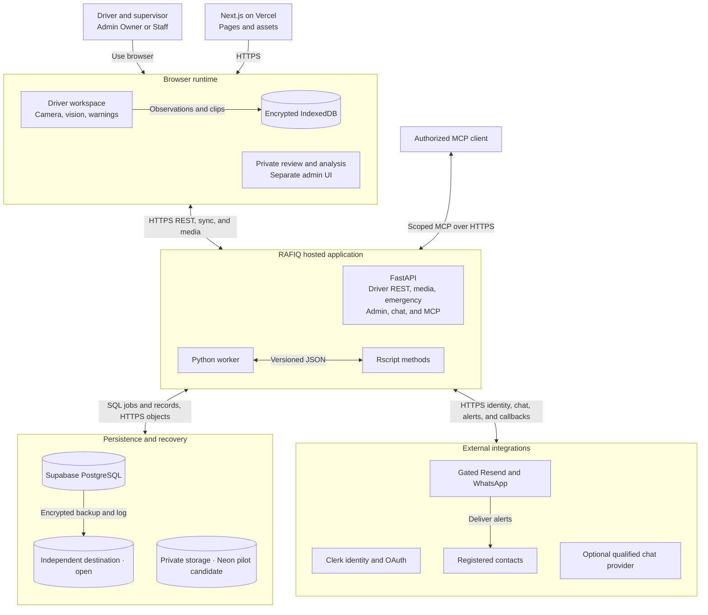

RAFIQ is a desktop-browser application for adults conducting controlled stationary monitoring sessions or approved supervised vehicle tests. It tracks visible driving behaviors, issues local warnings, and supports private history, incident clips, reproducible analysis, and agent-authored reports. Drivers, delegated supervisors, registered emergency contacts, compatible MCP clients, and RAFIQ administrators each have a distinct access boundary.

**Confirmed architecture baseline.** A hosted FastAPI modular monolith serves private operations. The browser owns time-critical monitoring and continues a configured session during a supported outage while the monitoring tab stays open. A Python worker runs durable jobs from PostgreSQL, and R computes the published statistical results. Next.js and TypeScript run the web surface, Clerk handles identity and OAuth, and Supabase PostgreSQL is authoritative for structured data. A Vercel frontend, the zero-project-cost release rule, and separate capability qualification are part of the planned baseline. The repository evidence is planning documentation and tooling. Here, **Confirmed** means specified or adopted in a project source, **Proposed** means a design introduced by this document, and **Open Question** means a decision or qualification is pending.

| Source | Authority |
| --- | --- |
| [PRD](PRD.md) | Product scope, actors, operating limits, release gates, and approved acceptance criteria. |
| [TRD](TRD.md) | Technical contracts, logical data model, pinned dependency baseline, and verification targets. |
| [Archived architecture spine](https://github.com/alisameh05/RAFIQ/blob/4923de79cb4c4b6a166091d0f3ef53a05a71ddfb/docs/planning-artifacts/architecture/architecture-RAFIQ-2026-11-20/ARCHITECTURE-SPINE.md) | Earlier decisions AD-1 through AD-8. Section 17 records the current decisions, including later changes to MCP, emergency delivery and optional chat. |
| [Application experience](EXPERIENCE.md) | Screen names, navigation, journeys, and state presentation. This is RAFIQ’s application-flow specification. |
| [Design foundations](DESIGN.md) | Visual direction and shared tokens, with RAFIQ-specific warning, focus, and chart treatments tracked separately in the experience handoff. |
| [Vision reuse](VISION-REUSE.md) | Selected pretrained components, upstream attribution, and the integration and qualification plan for M02. |
| [API specification](API.md) | Operation IDs, paths, wire contracts, examples, and unresolved API decisions. |
| [Archived contract review](https://github.com/alisameh05/RAFIQ/blob/4923de79cb4c4b6a166091d0f3ef53a05a71ddfb/docs/planning-artifacts/architecture/architecture-RAFIQ-2026-11-20/reviews/review-contracts.md) and [provider review](https://github.com/alisameh05/RAFIQ/blob/4923de79cb4c4b6a166091d0f3ef53a05a71ddfb/docs/planning-artifacts/architecture/architecture-RAFIQ-2026-11-20/reviews/review-providers.md) | Historical failure cases and qualification leads. Current PRD, TRD, and architecture govern their disposition. |

The diagram sequence follows the visual structure of the [Pravaha architecture](https://github.com/Monolithic-Dev/Pravaha/blob/main/docs/ARCHITECTURE.md). The boundaries below use the capability names from the TRD. The [API specification](API.md) maps them to URL paths, operation IDs, and wire schemas.

## 1. System Context (C4 Level 1)

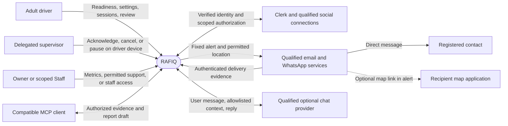

| Actor or boundary | Data and authority |
| --- | --- |
| Driver | Uses a verified account. Supplies consent and preferences, starts while stationary, and accesses only eligible own records, analysis, media, and reports. |
| Supervisor | A person on site with temporary delegation on the driver's device. May acknowledge warnings, cancel a countdown, or pause within the approved procedure. The driver retains start, resume, end, and account controls while stationary. |
| Emergency contact | Receives an alert and, when permitted and available, a map location or link directly. Recipient access to the message requires no RAFIQ session. WhatsApp requires its own opt-in. |
| MCP client | Exchanges scoped operations over HTTPS. Read and report-authoring authority are independent and revocable. Job access binds the driver, client, and authoring grant. |
| Admin Owner and Staff | Enter a separate invitation-only surface with verified identity and MFA. Staff permissions are assigned individually. Owner manages staff access and audit. The support interface exposes only approved account fields. |
| Clerk and optional social identity providers | Clerk supplies authenticated identity and MCP OAuth. Google and Apple production connections have independent qualification gates. RAFIQ enforces application permissions and account lifecycle. |
| Delivery and map providers | Receive the fixed message and the minimum destination data for the attempt. A separately consented usable location may be shared. Validated callbacks update recorded delivery state. |
| Optional chat provider | Receives the driver's messages and relevant allowlisted context for a currently authorized request. Provider availability and data handling are disclosed separately. |

Live camera frames and unused pre-event footage remain on the laptop. A consented bounded clip may cross into hosted storage through FastAPI. The driver account is the private data boundary across database, storage, MCP, and chat. Staff queries, worker claims, and provider callbacks each have their own narrow authority. University demonstration and supervised-use approval govern the applicable operating setup. Public signup follows product release approval and is available to eligible adults without university affiliation. [PRD §§2–3, 8](PRD.md) · [TRD §§2, 4, 6–7.1](TRD.md)

## 2. Architectural Style and Design Principles

**Confirmed.** Use a hosted modular monolith with on-device live monitoring and one separately run application worker. The browser keeps the warning path responsive during network loss. The API keeps authorization and data lifecycle in one place. PostgreSQL-backed jobs let expensive computation and rendering run outside requests and recover after interruption. A job lease provides publication authority, with a final source and grant check at the write boundary.

**Proposed.** Organize modules by product capability. Use a thin transport layer, application use cases with explicit inputs and outputs, and persistence and provider adapters behind narrow ports. Domain policy and calculations stay with their owner. The composition layer binds adapters and coordinates multi-module operations. Shared types cover only contracts that independent consumers must interpret consistently, such as elapsed timestamps, observation usability, stable identifiers, and provenance. Enforce direction with import checks, and test each capability with deterministic inputs and isolated adapter fixtures.

This arrangement trades independent service deployment for simpler transactions, fewer operational dependencies, and one product authorization boundary. It has two execution constraints. Browser resources must support CPU-only local feedback, and hosted resources must support jobs, media, and recovery at zero project cost. Measure each constraint before activation. [Current architecture decisions](#17-architectural-decisions-and-trade-offs) · [TRD §§1, 7–8](TRD.md)

## 3. System Module Decomposition

**Proposed module allocation.** A module is an ownership boundary. Browser features, FastAPI handlers, and worker handlers can participate in one capability while executing in different runtimes.

| ID and module | Responsibility and submodules | Main interface and data ownership | Runtime |
| --- | --- | --- | --- |
| M01 Accounts and Access | Identity, onboarding, preferences, lifecycle | Verify principal, check eligibility, manage profile and lifecycle. Owns driver identity and general preferences. | Browser UI and API |
| M02 On-device Monitoring | Readiness, capture feed, inference, timing, warning control | Accept a ready session context and local controls. Emit versioned observation and warning signals. Owns transient live state. | Driver browser |
| M03 Session Records and Sync | Encrypted queue, ingestion, recovery, history | Enqueue, unwrap, commit, acknowledge, finalize, and read. Owns durable session observations, device registrations, and sync receipts. | Browser and API |
| M04 Clips and Media | Consent, capture, library, private gateway | Produce consented clip, upload, list, stream range, revoke or delete. Owns consent, clip metadata, and private clip objects. | Browser and API |
| M05 Emergency Mode | Local eligibility, destinations, dispatch, delivery evidence | Configure contacts, confirm and claim attempt, apply callback, read status. Owns contacts, escalation sequences, and per-channel outcomes. | Browser and API |
| M06 Analytics and Evaluation | Personal dashboard, What-If, Studio, benchmark, R methods | Request a run, resolve a validated result, and publish approved aggregates. Owns analysis inputs, results, and controlled dataset versions. | Browser UI, API, worker, and R |
| M07 MCP and Reports | Grants, tool boundary, authoring, validation, exports | Read approved data, start and author a report as an agent, review and export as a driver. Owns product grant bindings, snapshots, and export state. | Browser UI, API, and worker |
| M08 Optional Chat | Provider connections, consent, context, temporary chat | Link, consent, send, revoke, and disconnect. Owns connection state and transient conversation. | Browser UI and API |
| M09 Administration | Staff access, MFA, health, adoption, support, audit | Enforce admin grants, release aggregates, look up exact accounts, and audit authorized changes. Owns admin and adoption records. | Browser UI, dedicated API surface, and worker |
| M10 Platform Operations | Configuration, jobs, telemetry, migrations, recovery | Claim and complete jobs, emit approved health samples, coordinate retention and restore. Owns generic job state and operational records. | API, worker, and deployment tasks |

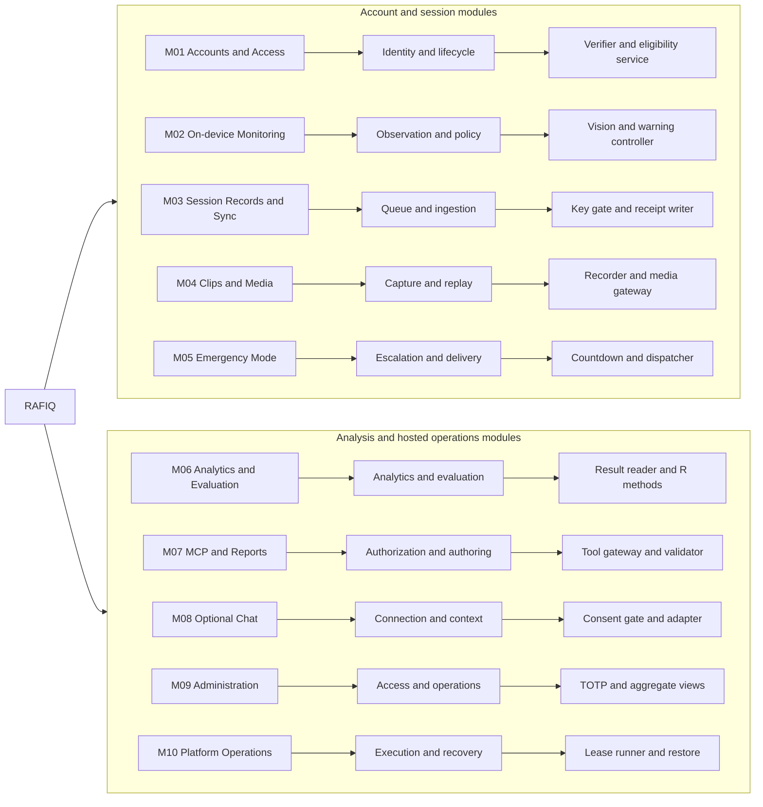

## 4. Detailed Module Architecture

Component names and locations in this section are **Proposed**. Their governing behavior comes from the linked requirements. Dependency IDs point to the public interfaces in §5.

### Module M01 — Accounts and Access

- **Purpose and responsibilities.** Establish verified driver identity, onboarding, current eligibility, profile and general preferences. Bind lifecycle state to the verified Clerk subject. Clerk owns credentials, verification, and recovery. Admin authorization, recording consent, and delivery destinations have separate owners.
- **Submodules and components.** Identity (`Clerk verifier`, `Driver resolver`), onboarding and profile (`Acceptance service`, `Preferences store`), lifecycle (`Eligibility service`, `Account lifecycle service`).
- **Interfaces and data.** A verified Clerk assertion or permitted lifecycle operation yields a driver principal, eligibility result, or audited account transition. Owns the driver record, acceptance revision, and general preferences. Exposes a narrow support interface to M09. External integration is Clerk, with qualified Google and Apple through Clerk.
- **Security and errors.** Reject invalid, unverified, expired, or restricted authority before loading private data. Link only through verified Clerk flows, including the Apple relay case. Reinstatement requires fresh identity and fresh MCP consent. During suspension, an already configured offline session can continue its local warning path within its existing limits.
- **Proposed files.** `web/src/features/accounts/` and `server/rafiq/accounts/`. [TRD §§4, 7.1](TRD.md)

### Module M02 — On-device Monitoring

- **Purpose and responsibilities.** Run stationary readiness, the camera feed, local CPU inference, elapsed clock, versioned policy, display and audio warnings, and pause, resume, and end state. The baseline catalog covers drowsiness, distraction, active phone use, eating, and drinking. Reaching is a candidate class requiring separate qualification. M03 owns durable ingestion, M04 recording, and M05 the contact escalation state.
- **Submodules and components.** Readiness (`Readiness controller`, `Asset verifier`), observation (`Camera adapter`, `Vision adapter`, `Observation clock`), policy and feedback (`Behavior evaluator`, `Warning controller`, `Session controller`).
- **Vision pipeline.** Adapt Driver Monitor's browser worker and face and hand cue extraction around pretrained MediaPipe Face and Hand Landmarker on CPU. Run OpenCV Zoo NanoDet as the sole object detector through ONNX Runtime Web with WebAssembly on CPU. The Vision adapter combines timestamped landmarks and object detections for the behavior evaluator. See the [pipeline and qualification evidence](TRD.md#21-pretrained-browser-vision).
- **Interfaces and data.** Takes an eligible session context, the verified vision bundle, camera frames, and local controls. The Vision adapter delivers independently observable cues with monotonic capture times. The behavior evaluator owns class scores and RAFIQ's versioned dwell, recovery, and overlapping detections. M02 supplies versioned observation, warning, usability, and lifecycle signals to local consumers. Frames, raw landmarks, object detections, and current timers stay in browser memory.
- **Security and errors.** Request video only. Permission denial or an unverified or uninitialized bundle blocks start. A class whose required cues are unavailable contributes neither a positive nor a confirmed negative. When the feed as a whole is unusable, override warnings, record the pause interval, and require usable observation plus manual resume. Supervisory controls are explicit, temporary, and session-local. Connectivity loss leaves the configured local loop active.
- **Proposed files.** `web/src/features/monitoring/`. [PRD §5.2](PRD.md) · [TRD §§1–2](TRD.md)

### Module M03 — Session Records and Sync

- **Purpose and responsibilities.** Preserve the driver-owned session record and resume eligible durable writes after interruption. Maintain authoritative session status and provide history, timeline, observation, and source-eligibility reads. M04 controls clip eligibility and byte transfer.
- **Submodules and components.** Local durability (`Encrypted queue`, `Sync client`), ingestion and recovery (`Device key gate`, `Batch validator`, `Receipt writer`, `Session finalizer`), history (`Session and observation repository`, `History reader`).
- **Interfaces and data.** Consumes M02’s local versioned events and uses M01’s current eligibility. Accepts a session and item IDs, elapsed and capture times, and versions. Returns post-commit per-item outcomes and authorized history. Owns device registrations, sync receipts, sessions, intervals, detections, incidents, warnings, and retained measurement series. Uses Web Crypto and IndexedDB locally and PostgreSQL through the API.
- **Security and errors.** The queue is bound to driver and device. Only same-driver eligible online reauthentication unlocks recovery. Clear usable keys and private UI state across tabs on sign-out. Identical replay acknowledges the original commit, conflicting replay is rejected, retryable items stay queued, and deletion or expiry prevents re-creation. Recovered interrupted sessions finalize at the last durable observation.
- **Proposed files.** `web/src/features/session_records/` and `server/rafiq/session_records/`. [TRD §§2–4](TRD.md)

### Module M04 — Clips and Media

- **Purpose and responsibilities.** Manage recording consent and bounded incident capture, private upload and replay, and clip expiry and deletion. The live feed and unused buffer stay local. Report exports belong to M07 and use its authorized artifact boundary.
- **Submodules and components.** Consent and recording (`Consent service`, `Clip recorder`), persistence (`Upload finalizer`, `Private object adapter`), review (`Clip library`, `Media gateway`).
- **Interfaces and data.** Takes M02 incident and readiness signals, M03 owned incident references and encrypted queue operations, and M01 eligibility. Returns clip status, authorized metadata, or streamed bytes. Owns recording consent revisions, private object references and bytes, sizes, capture and expiry, and truncation. The pilot object adapter uses the Neon S3-compatible candidate.
- **Security and errors.** Check account, owner, source incident, consent, expiry, size, and quota at admission and before availability. Authorize each playback request and range. Revocation stops capture and discards unsent clips. Keep partial objects private and purge orphans. When capture or queue limits are reached, mark affected clips unavailable while warnings continue.
- **Capture bounds.** Default to three seconds before and after the qualifying incident, with independent 0–5 second settings. Keep the first bounded segment, at most 30 seconds and 20 MB, and display truncation. The offline clip queue caps at 100 MB or 20 clips, whichever comes first.
- **Proposed files.** `web/src/features/clips/` and `server/rafiq/clips/`. [PRD §8.6](PRD.md) · [TRD §§1–4](TRD.md)

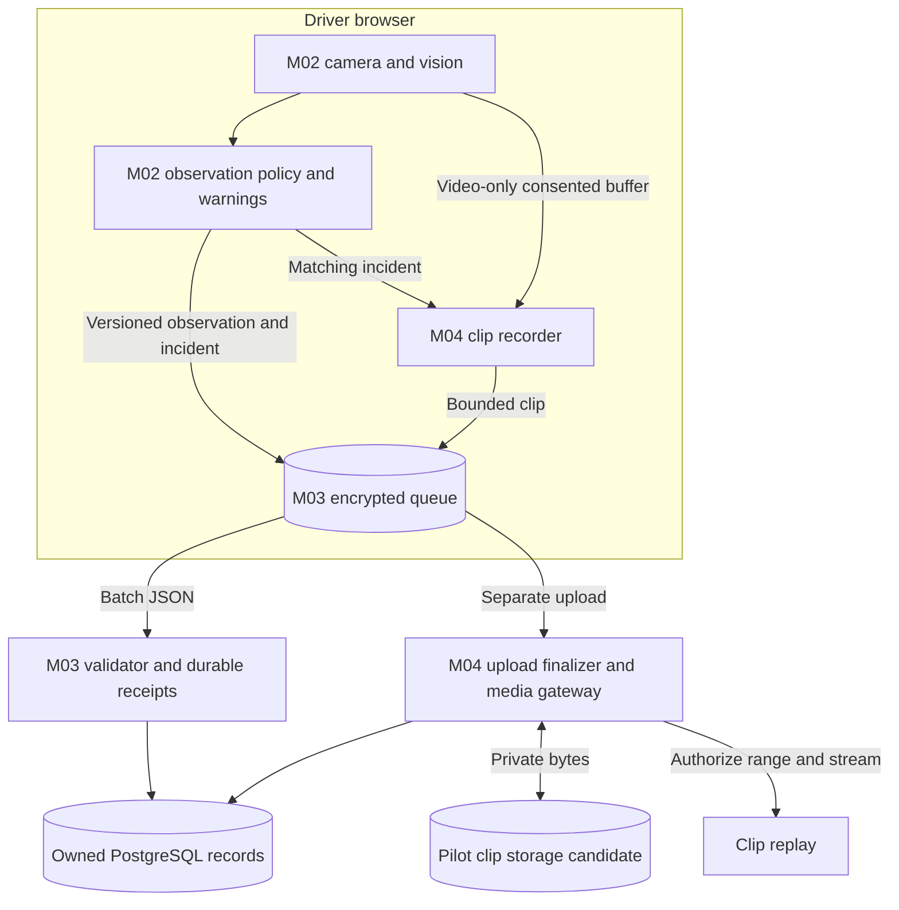

### Module M05 — Emergency Mode

- **Purpose and responsibilities.** Run local sustained-drowsiness qualification and cancellation in eligible supervised sessions. Own ordered contacts, channel eligibility, dispatch, and delivery reconciliation. Regular warning acknowledgment is an M02 control and leaves escalation state unchanged.
- **Submodules and components.** Local escalation (`Dwell and countdown controller`, `Live confirmation`), contact management (`Contact and destination registry`), delivery (`Attempt dispatcher`, `Resend adapter`, `PyWa adapter`, `Callback verifier`).
- **Interfaces and data.** Uses current M01 eligibility, M02 live qualification and cancellation, and M03 session identity and lifecycle. Accepts a fresh online confirmation and eligible destination version for each attempt. Exposes sequence and per-channel status to authorized session review. Owns ordered contacts, destination versions, separately permitted coordinates, attempts, and callback event identities. Integrates with Resend and the official WhatsApp Cloud API.
- **Security and errors.** Consume the single-use confirmation and claim the unique attempt before the provider call. Recheck recovery, cancellation, camera pause, session end, consent, destination and deadline immediately before dispatch. Ambiguous attempts remain unconfirmed at expiry and cannot be sent again. Fallback requires terminal failure across the current contact’s eligible attempts or no eligible channel. Verify signed callbacks and deduplicate events.
- **Proposed files.** `web/src/features/emergency/` and `server/rafiq/emergency/`. [PRD §8.5](PRD.md) · [TRD §6](TRD.md)

### Module M06 — Analytics and Evaluation

- **Purpose and responsibilities.** Produce personal dashboard and simulation results, approved Studio aggregates, and held-out benchmark evidence. Maintain versioned R methods and result provenance. Simulation results are isolated from live policy and private histories stay outside controlled datasets.
- **Submodules and components.** Personal review (`Analysis planner`, `Result reader`), replay (`Compatibility validator`, `Simulation handler`), controlled evaluation (`Study runner`, `Benchmark scorer`, `Disclosure check`), computation (`Input preparer`, `R runner`, `Result validator`).
- **Interfaces and data.** Uses M01 eligibility, M03 eligible session evidence, M05 approved outcome statuses, and M10 leased execution. Takes versioned filters, timestamps, compatible measurement series, and approved study inputs. Returns validated results with units, denominators, sample counts, coverage, method and input revisions. Owns runs, validated results, simulations, datasets, and benchmark release records. Uses NumPy and pandas for preparation and pinned R with renv and jsonlite for computation.
- **Security and errors.** Recheck owner and source eligibility before publication. Invalidate affected results on deletion or expiry. Withhold unsupported inference or accuracy with an explicit reason. Require at least 10 distinct participants in each visible Studio group and apply complementary suppression. Lease loss or stale input prevents publication, and a valid reclaim can rerun the same logical job.
- **Proposed files.** `web/src/features/analytics/`, `server/rafiq/analytics/`, and `server/r/analytics/`. [TRD §5](TRD.md)

### Module M07 — MCP and Reports

- **Purpose and responsibilities.** Provide the scoped remote MCP gateway and agent-only report authoring. Validate structured claims against R evidence and freeze a review snapshot. Serve owner-only review, PDF and Word from the same snapshot. Chat and browser sessions have review or consent operations appropriate to their audience.
- **Submodules and components.** Authorization (`MCP grant guard`, `Tool gateway`), authoring (`Report job service`, `Evidence assembler`, `Draft validator`), publication (`Snapshot publisher`, `Export renderer`, `Download guard`).
- **Interfaces and data.** Uses M01 subject and eligibility, M03 eligible summary and event data, M06 validated analytics and benchmark figures, and M10 jobs. An authorized agent reads approved fields or starts a job, fetches approved evidence, checks status, and submits a draft. An eligible driver reviews and requests exports. Owns grant bindings, authoring jobs’ business state, source links, immutable snapshots, and export metadata. Integrates with Clerk OAuth, WeasyPrint, and python-docx.
- **Security and errors.** Verify token audience, status and scope, owner, initiating client and grant, and current source validity. Filter fields to PRD §8.8. Rejected drafts get revision feedback. Repeat submissions are idempotent. Recheck before release and download, withhold stale jobs, and withdraw reports on source loss.
- **Proposed files.** `web/src/features/reports/` and `server/rafiq/reports_mcp/`. [PRD §§8.6, 8.8](PRD.md) · [TRD §§5–6](TRD.md)

### Module M08 — Optional Chat

- **Purpose and responsibilities.** Connect an independently qualified subscription provider and support a temporary driver conversation. Owns linking and consent for chat. MCP report authoring and its grants remain with M07.
- **Submodules and components.** Linking (`Provider connection service`), context (`Consent gate`, `Context assembler`), conversation (`Chat UI`, `Provider adapter`, `Response validity check`).
- **Interfaces and data.** Uses M01 driver eligibility, M03 eligible session and event metadata, and M06 checked results. Takes the driver's message and active connection, returns the provider reply or an actionable state. Owns encrypted provider credentials, connection and consent state, and memory-only application conversation. Uses official subscription-backed integration when qualified.
- **Security and errors.** Check current ownership, connection, consent, and allowlist before each send. Discard application conversation on close or sign-out. Clear chat and withhold invalidated replies on revocation or disconnect. Handle expired connection, unavailable provider, and exhausted allowance per experience. Exclude conversation content and credentials from logs.
- **Proposed files.** `web/src/features/chat/` and `server/rafiq/chat/`. [PRD §§8.8–8.9](PRD.md) · [TRD §6](TRD.md)

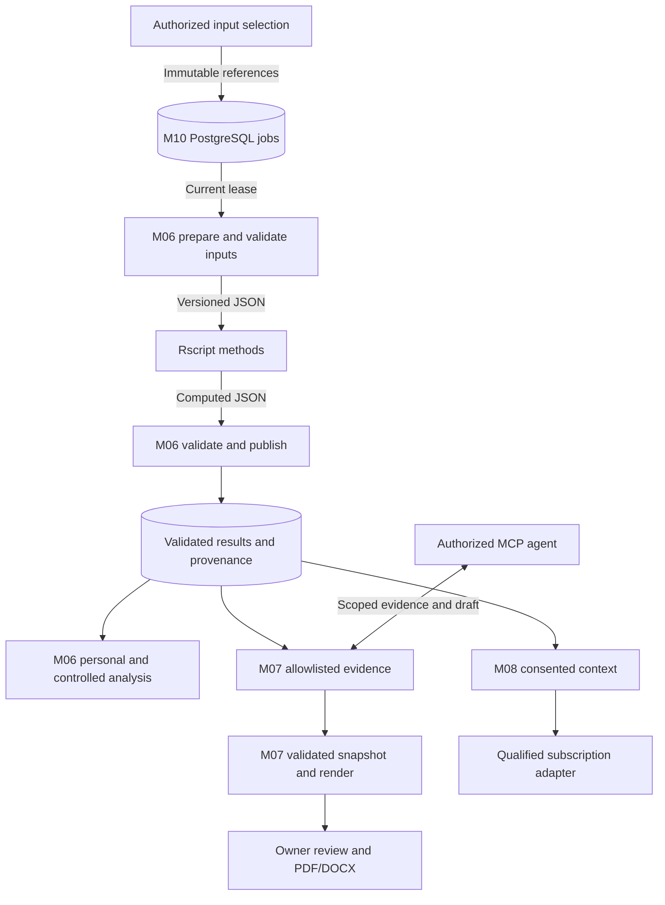

### Module M09 — Administration

- **Purpose and responsibilities.** Provide invite-only Service Health, Release Readiness, Adoption, Account Support, Staff Access, and Audit. Keep staff actions and aggregate reads behind a dedicated admin API and role. Release gates are read-only in this surface.
- **Submodules and components.** Staff access (`Invitation service`, `TOTP gate`, `Recovery service`), health and adoption (`Health reader`, `Readiness reader`, `Adoption projection`, `Disclosure gate`), support and audit (`Exact lookup`, `Support actions`, `Audit writer`).
- **Interfaces and data.** Uses M01's narrow account support and lifecycle operations, M06's R execution contract for adoption computation, and M10 telemetry, evidence references, and jobs. Composition supplies deduplicable signup, verification, and durable completion facts. Owns admin principals, invitations, permissions, MFA state, restricted adoption inputs and published aggregates, and audit events. Support responses expose only account ID, registered email, verification status, account status, and signup date. Clerk authenticates the identity and supplies eligible verification and recovery messaging.
- **Security and errors.** Verify TOTP bound to the Clerk session and current grant each request, with fresh verification for sensitive actions. Serialize Owner changes, rate-limit support actions, and audit lookup and changes. Suppress groups with fewer than 10 distinct contributors, including groups inferable across filters and revisions. Distinguish stale signals, confirmed outages, incomplete cohorts, and suppression. Use the audited recovery path if the last Owner loses MFA access.
- **Proposed files.** `web/src/features/admin/`, `server/rafiq/admin/`, and `server/r/adoption/`. [PRD FR-22](PRD.md#57-admin-dashboard) · [TRD §7.1](TRD.md#71-admin-dashboard-fr-22)

### Module M10 — Platform Operations

- **Purpose and responsibilities.** Provide runtime configuration, database roles and migrations, durable execution, privacy-filtered telemetry, and recovery and purge coordination. Capability owners govern policy and data eligibility. Platform scheduling and logging use narrow contracts supplied through composition.
- **Submodules and components.** Runtime (`Config loader`, `Database transaction factory`, `Migration entry point`), execution (`Lease store`, `Worker runner`), operations (`Telemetry emitter`, `Backup and change-log writer`, `Restore verifier`, `Purge scheduler`).
- **Interfaces and data.** Takes registered handlers, job requests, approved telemetry, and lifecycle markers. Returns lease state, operational samples, and restore checkpoints. Owns generic job state, operational telemetry, and recovery metadata. Uses PostgreSQL and a to-be-qualified independent recovery destination.
- **Security and errors.** Isolate runtime, worker, and migration credentials. Reclaim expired job leases with publication fencing. Alert on backlog, quota, backup lag, and overdue purge with allowlisted data. Restore in isolation, reconcile object and job state, and reapply current deletion, expiry, suspension, and revocation before serving reads.
- **Proposed files.** `server/rafiq/platform/`, `server/rafiq/worker/`, `server/migrations/`, and `ops/`. [TRD §§7–8](TRD.md)

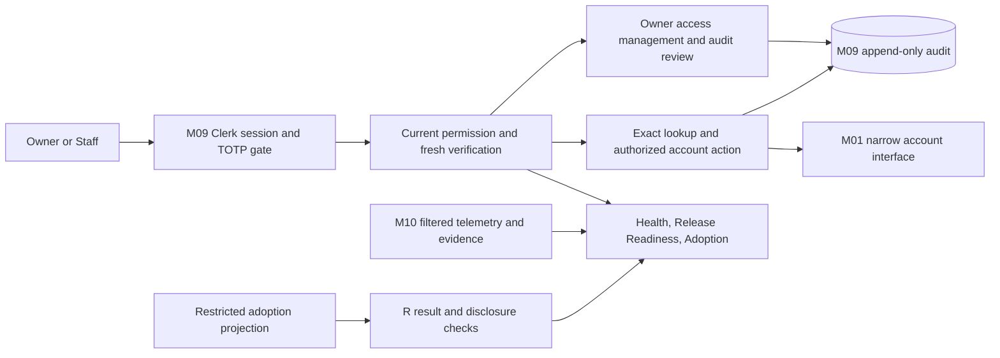

## 5. Module Dependency Architecture

**Proposed dependency rule.** A row may consume the marked columns’ public interfaces. `local` is a browser-only dependency on local events or queue operations. `read` and `use` cover authorized capability interfaces and narrow execution ports. Dashes are forbidden direct dependencies. Authenticated request context, endpoint composition, and shared transport types sit outside the feature import graph.

| Consumer | M01 | M02 | M03 | M04 | M05 | M06 | M07 | M08 | M09 | M10 |
| --- | --- | --- | --- | --- | --- | --- | --- | --- | --- | --- |
| M01 Accounts and Access | — | — | — | — | — | — | — | — | — | — |
| M02 On-device Monitoring | — | — | — | — | — | — | — | — | — | — |
| M03 Session Records and Sync | use | local | — | — | — | — | — | — | — | — |
| M04 Clips and Media | use | local | use | — | — | — | — | — | — | — |
| M05 Emergency Mode | use | local | read | — | — | — | — | — | — | — |
| M06 Analytics and Evaluation | use | — | read | — | read | — | — | — | — | use |
| M07 MCP and Reports | use | — | read | — | — | read | — | — | — | use |
| M08 Optional Chat | use | — | read | — | — | read | — | — | — | — |
| M09 Administration | use | — | — | — | — | use | — | — | — | use |
| M10 Platform Operations | — | — | — | — | — | — | — | — | — | — |

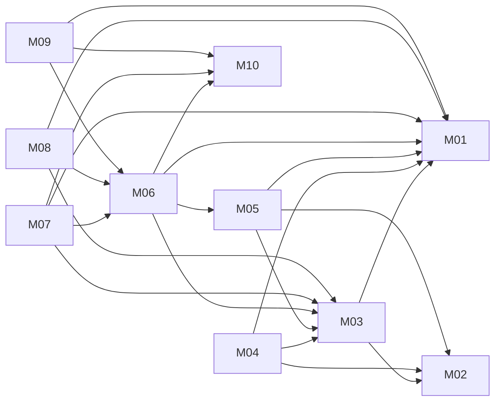

For cross-module operations such as session detail, account deletion, adoption input projection, and suspension, the composition layer calls the relevant owner interfaces. For example, it reads analytics, then resolves a clip reference through M04. M06 can compute from an eligible session even if the clip is absent. Suspension commits account ineligibility before grant invalidation and UI cleanup complete. Current lifecycle checks deny hosted access during that interval. Each module uses its own repository. Related rows carry owner-aware references, and broad database access is restricted to migration and restore procedures.

Keep the versioned observation and result contracts at explicit public boundaries. Keep providers, ORM models, query builders, and component internals private to their implementation packages. Inject port implementations and register job handlers at startup. Add static import checks for allowed module edges, forbidden internal imports, and cycles in TypeScript and Python once the source layout exists. Avoid moving domain rules into shared utilities. [TRD §§2–5, 7.1](TRD.md)

## 6. Frontend Architecture

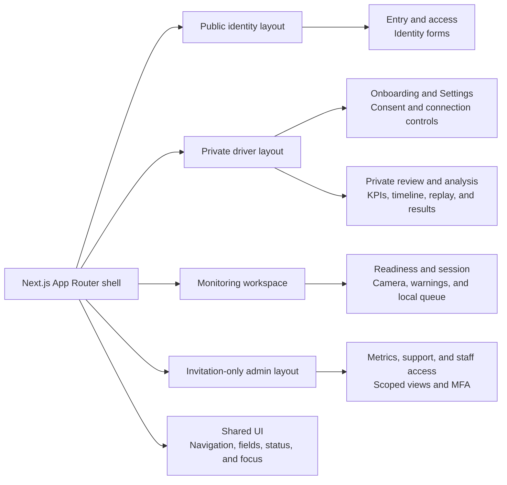

Screen names and groupings are **Confirmed** from the information architecture. Component allocation is **Proposed**. The driver navigation is Dashboard, Sessions, Clips, Analysis, Reports, and Settings, with Start session as a separate action. Analysis opens What-If and links to Experiment Studio and Benchmark. Monitoring prioritizes the session workspace. A permitted direct destination can resume after authority is verified. [Experience information architecture](EXPERIENCE.md#information-architecture)

| Screen or surface | Feature modules | Principal components | API or local operation |
| --- | --- | --- | --- |
| Public entry and account access | M01 | Signup, sign-in, verification and recovery forms | Clerk identity operations, account eligibility |
| Controlled-use onboarding | M01 | Conditions and acceptance form | Read applicable conditions, record versioned acceptance |
| Dashboard | M03, M06 | Latest-ready session view, pending-session status, Start session entry | Read session status and eligible validated analytics |
| Start session and readiness | M01, M02, M03, M04, M05 | Readiness checklist, preview, consent and supervisory options | Verify account and conditions, initialize session context, verify camera and local assets |
| Monitoring and end status | M02, M03, M04, M05 | Observation panel, warning actions, capture indicator, queue and alert status | Local observe, acknowledge, pause, resume and end, plus authorized sync, upload and alert confirmation |
| Sessions and Session Detail | M03, M04, M05, M06 | History, timeline, KPI cards, incident and alert details | List owned sessions, read results, resolve replay, delete session |
| Personal Overview | M06 | Period and behavior filters, KPIs, trends, comparisons and findings | Read or refresh validated results for the selected scope |
| Clips and clip replay | M04 | Filtered clip list, incident context, player, deletion dialog | List eligible clips, authorize each byte range, delete clip |
| What-If | M06 | Source selector, supported threshold form, saved comparison | Run compatible owner-only replay, read baseline and result |
| Experiment Studio | M06 | Dataset, conditions and method form, result and export controls | Run approved study, read and export disclosure-eligible aggregate |
| Benchmark | M06 | Version, coverage, class metrics and limitations | Read approved held-out aggregate |
| Reports | M07 | Report status, snapshot review, export controls | Read owner-visible status and snapshot, request PDF or DOCX |
| Settings | M01, M02, M04, M05, M07, M08 | Profile, Monitoring, Emergency contacts, Privacy, Connections and temporary chat | Manage preferences, destinations, consent, deletion, MCP grants and provider connections, send a chat message |
| Restricted account | M01 | Account status, support contact, fresh sign-in entry | Read current eligibility and begin new sign-in when eligible |
| Admin entry | M09 | Bound invitation, sign-in, authenticator challenge, recovery | Accept invite, establish session-bound TOTP verification or recover access |
| Service Health and Release Readiness | M09, M10 | Signal status, channel counts, freshness and evidence | Read permitted operational metrics and read-only gate evidence |
| Adoption | M09 | Privacy-checked funnel, usage cards, trends and date range | Read disclosure-checked result for requested range |
| Account Support | M09, M01 | Exact lookup, permitted action forms, reason and re-verification | Lookup, request verified identity message, suspend or reinstate |
| Staff Access and Audit | M09 | Staff invitations, scope and Owner management, MFA reset, audit filters | Manage current grants and read authorized audit history |

**Proposed state boundaries.** Keep camera, timers, acknowledgement, and capture state in the monitoring workspace. Share only versioned local events across consumers. Preserve non-sensitive navigation state such as selected filters when returning from a detail view. Scope authorized query state by principal and operation, keep private responses out of shared caches, and clear local private state on sign-out or account switch. Prefer lightweight status refresh for sync and job progress, with the browser’s local loop driving live feedback. Use form validation for timely feedback and FastAPI validation at authorization and commit boundaries.

Use page-level error boundaries for hosted review and admin requests and a separate state boundary for the active monitoring workspace. Distinguish loading, saving, syncing, empty, ready, and unavailable states. Recover camera access with a usable view and explicit resume. Preserve older ready results while eligible newer data syncs, with scope visible. Keep keyboard and screen-reader use, non-color warnings, audio opt-out, accessible timeline controls and data tables, and meaningful focus restoration. Motion presentation and delegated controls follow the approved procedure. [Experience state patterns and accessibility](EXPERIENCE.md#state-patterns) · [Design foundations](DESIGN.md)

## 7. Backend Architecture

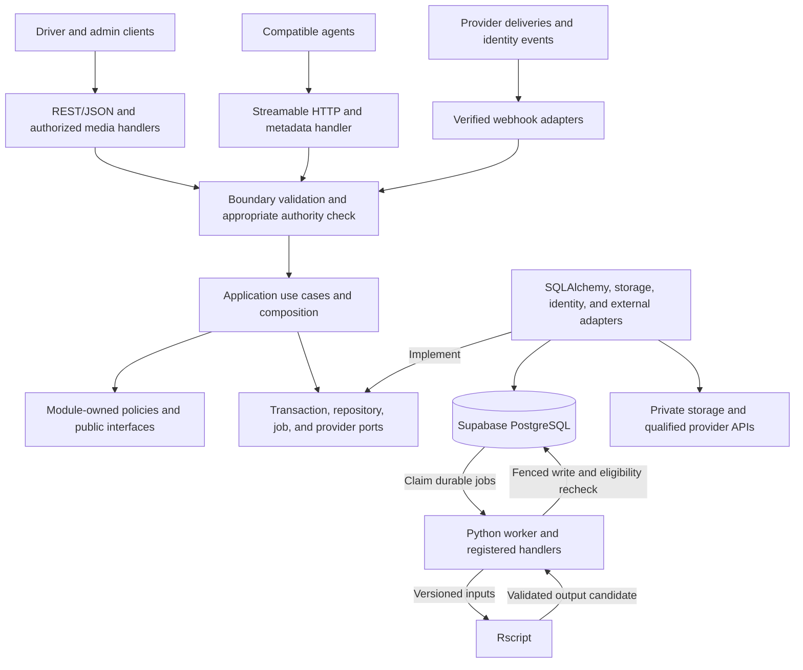

**Proposed layering.** Transport validates input, resolves identity and maps safe outcomes. Application use cases apply current authority, coordinate owned operations, and define commit boundaries. Domain policies depend on explicit inputs. Adapters implement the persistence or provider contracts they serve. Composition injects configuration, database sessions, and clients at startup. Use the TRD’s environment-specific secrets and reproducible dependency baseline. API and worker use compatible versions of shared contracts, migrations, and work definitions.

| Request path | Processing and transaction boundary |
| --- | --- |
| Sync observations | Verify driver and context, validate item and parent, write observations and receipts atomically per accepted item, then return outcomes. |
| Stream a clip | Verify account, owner, source and eligibility for the requested byte range. Resolve the private object within the gateway and stream through FastAPI with private cache behavior. |
| Start and complete analysis | Check input eligibility, enqueue a logical run with immutable inputs, and return status. A handler claims the lease, prepares inputs, calls Rscript, validates output and publishes once under the current lease with final eligibility checks. |
| Dispatch an emergency attempt | Verify live confirmation and applicable eligibility, consume it and claim the unique attempt atomically, then call the qualified adapter. Record callbacks idempotently. |
| Suspend an account | Verify current Staff scope and fresh MFA, then commit lifecycle and audit together. Revoke existing authority and recheck current lifecycle at subsequent reads and commits. |

Use SQLAlchemy and psycopg with least-privilege roles, Alembic migrations, and trusted transaction-local owner context. Provider calls that are outside the database transaction use persisted intent, state, and explicit reconciliation where needed. For example, clip upload and provider acceptance have separate points at which the capability becomes available or confirmed delivered. [TRD §§1–7.1](TRD.md)

## 8. API and Communication Architecture

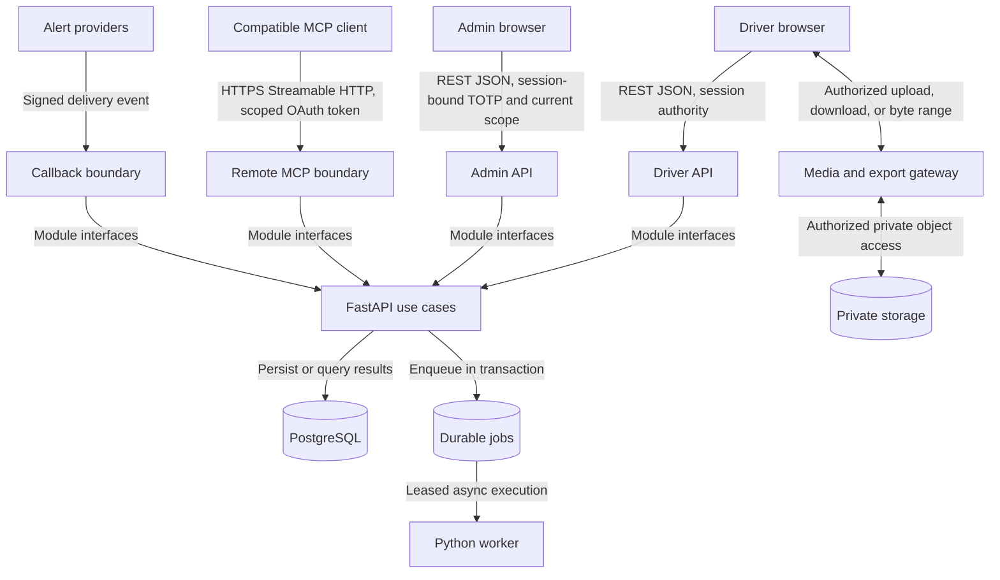

| Operation family | Caller and authority | Input → result | Failure and retry |
| --- | --- | --- | --- |
| Account, onboarding, settings | Verified driver and current eligibility | Identity, acceptance or preferences → authorized account state | Return applicable verification or restricted state. Re-read current state after auth changes. |
| Unwrap, sync, and finalize session | Same eligible driver for registered device and owned session | Device binding or versioned batch → usable key under the authorized flow, item outcomes, session status | Retry pending items with stable UUIDs. Reject conflicting replays. Retire expired or permanently ineligible items. |
| Upload, replay, and delete clips | Owner, consent and source checks where applicable | Stable clip ID and video bytes, range, or deletion request → private status or bytes | Retry with same ID while eligible. Keep partial uploads private. Stop access on deletion or expiry. |
| Review or run analysis | Owner for private scope, approved sources for controlled analysis | Session and filters, compatible replay or approved study → current validated result or queued status | Keep the last eligible scope visible where appropriate. Return reason for unavailable, unsuitable or suppressed output. |
| Confirm emergency and apply delivery event | Active eligible supervised tab with fresh single-use confirmation, or verified provider callback | Session, sequence, destination version and channel, or authenticated event → attempt outcome | Stop stale confirmation. Deduplicate callbacks. Preserve uncertain attempts through deadline without repeating the provider call. |
| Read MCP data or author report | Compatible OAuth client with current read or authoring grant, owner and job binding | Approved query or structured draft → allowlisted fields, opaque job status, or draft validation outcome | Deny expired or revoked authority. Correct a rejected draft and submit again. An identical accepted submission yields the same snapshot. |
| Review and export reports | Current verified driver and eligible owned snapshot | Report and requested export format → reviewed figures and protected artifact | Reissue from an eligible snapshot after link expiry. Deny access to withdrawn or expired sources. |
| Link and use chat | Current verified driver, qualified provider, and current consent | Link action, message and approved context → provider reply or connection state | Show unavailable, expired, or exhausted states. Reconnect or retry only as applicable. Drop replies invalidated before release. |
| Admin metrics, support, and access | Active admin principal with matching scope and TOTP, plus fresh verification for sensitive actions | Range, exact account key, or permitted action → approved result or audit-backed outcome | Apply per-actor and per-target rate limits to identity messages. Make duplicate requests idempotent. Show safe partial or unavailable metrics. |

MCP reads and chat context may include only eligible owner session IDs and timestamps, duration, coverage, behavior and incident counts, validated aggregates with units and methods, and event ID, class, relative start time, duration, and severity. Report job evidence follows the same data boundary. The remote tool set is limited to approved reads and scoped authoring. [PRD §8.8](PRD.md#88-mcp-qualification-and-data-boundaries)

Use synchronous HTTPS for authorized reads and commits. Represent longer runs and rendering with durable status. Apply input bounds and provider deadlines at each boundary. Use bounded retries for retryable sync and jobs while retaining stable identities. Outbound emergency attempts follow the at-most-once application contract. Keep external error text and private data out of public error payloads and logs. Exact transport status codes, headers beyond requirements such as byte ranges, schema versions, and timeout values belong to the API or provider contracts where the TRD does not specify them. [TRD §§2, 4–6, 7.1](TRD.md)

## 9. Core Application Workflows

These workflows map to the eight [experience journeys](EXPERIENCE.md#key-flows). Component names follow the proposed ownership in §4. Product behavior and qualification come from the PRD and TRD.

### J1. First controlled session

An eligible adult verifies their public account, accepts the current conditions, and starts while stationary. Camera permission, a usable feed, prepared local assets, and a recording consent decision are prerequisites. Declining recording still permits monitoring. The successful journey ends in a ready session summary or a status that leads to it after required sync and analysis. [PRD UJ-1 and AC-01, AC-04](PRD.md) · [TRD §2](TRD.md)

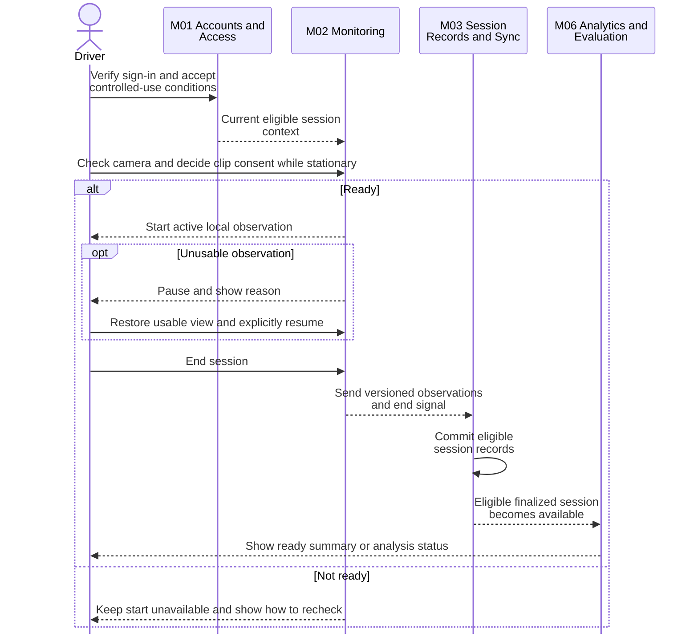

### J2. Private recovery, clips, and deletion

An open configured monitoring tab continues on-device during connectivity loss. Closing, reload, or a crash ends observation and leaves committed ciphertext locked until the same eligible driver returns online. Recover structured records first so dependent uploads can resolve an owned incident. Enforce clip limits and lifecycle independently. [TRD §§2, 4](TRD.md) · [PRD §§8.4, 8.6](PRD.md)

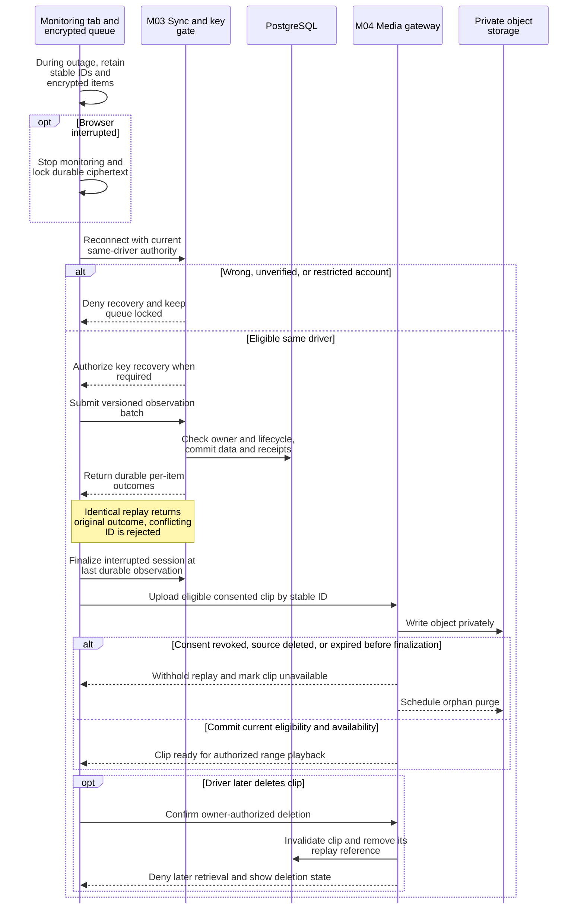

Session and account deletion use their owners’ operations through composition. Dependent media and reports become unavailable when their required sources are deleted or expire. Physical purge proceeds under the retention contract.

### J3. Supervised warnings and emergency delivery

Eligible supervised sessions can use independently qualified channels. Controlled validation starts with 10 seconds of continuous qualifying drowsiness and a separate 15-second cancellation window. The attempt deadline is 120 seconds from the start of that window. Warning acknowledgment is separate from cancellation. Camera pause, observed recovery, cancellation, and session end override unsent attempts. Manual resume starts fresh qualification. [PRD §8.5](PRD.md) · [TRD §6](TRD.md)

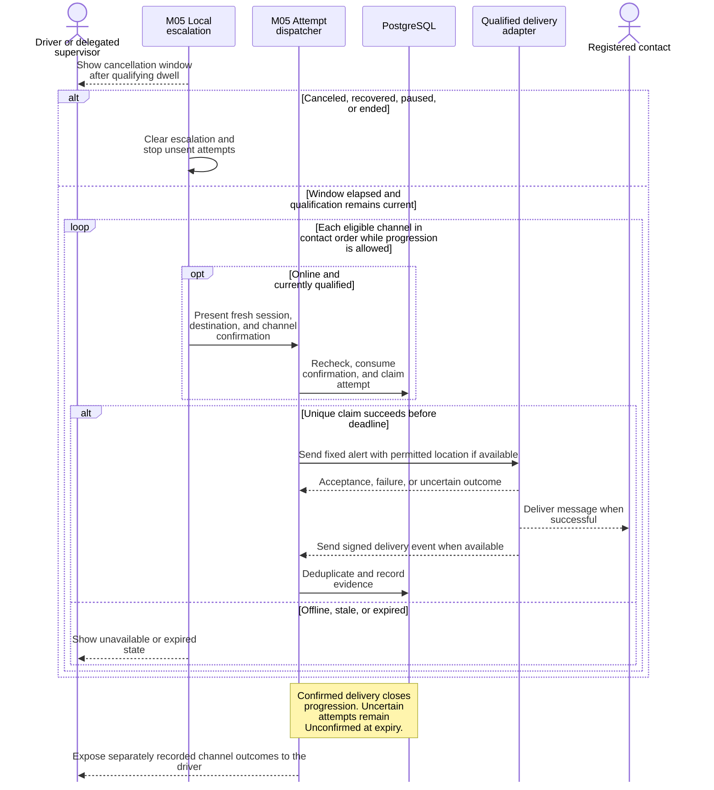

For each contact, skip unavailable channels and advance only when the contact has no eligible channel or all eligible attempts reach terminal failure. Send the fixed message with a location-unavailable notice when separately permitted coordinates are unavailable. A provider call interrupted after the claim stays claimed. Neither recovery nor callback replay initiates another send. A later bounce can update status after closure without reopening the sequence. [PRD §8.5](PRD.md) · [TRD §6](TRD.md)

### J4. Review sessions and compare periods

Dashboard opens the latest completed session with ready analytics. Session Detail keeps elapsed-timeline zoom separate from its KPI scope. Personal Overview supports date and behavior filters and comparison of up to four selected sessions. Keep available descriptive results when findings are withheld for exposure, coverage, or comparability. Missing optional clips leave analytics available. [PRD FR-14](PRD.md#55-personal-analytics-simulation-and-controlled-experiments) · [TRD §5.1](TRD.md#51-personal-dashboard-fr-14)

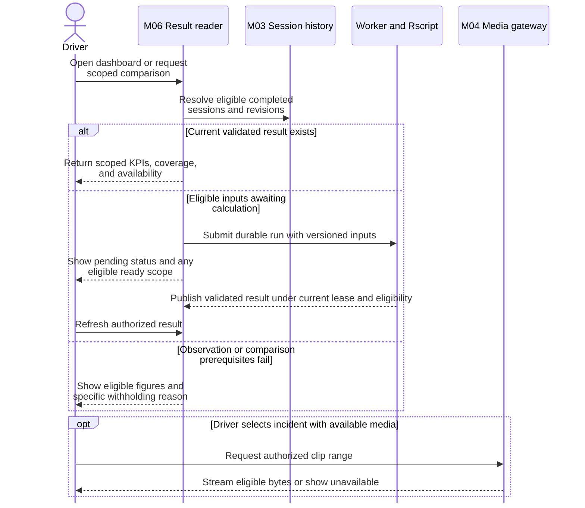

R owns pooled counts and exposure, usable-time unions, coverage, overlap, time bins, and comparison eligibility. The API supplies result provenance and status. The UI distinguishes observed zero, unavailable denominators, pending data, and known observation gaps. It uses the recorded warning and emergency outcome statuses and approved comparability rules. [TRD §5.1](TRD.md#51-personal-dashboard-fr-14)

### J5. Simulate, run a study, and interpret the benchmark

Run owner-only What-If against compatible retained measurements. Run Studio over approved synthetic fixtures and approved predefined studies. Score benchmark data on a held-out driver-disjoint split using frozen labels, versions, and methods, then publish qualified aggregates. The driver can inspect the published benchmark alongside simulation and study outputs. [PRD §§8.3, 8.7](PRD.md) · [TRD §5](TRD.md#5-statistical-analysis-and-reports)

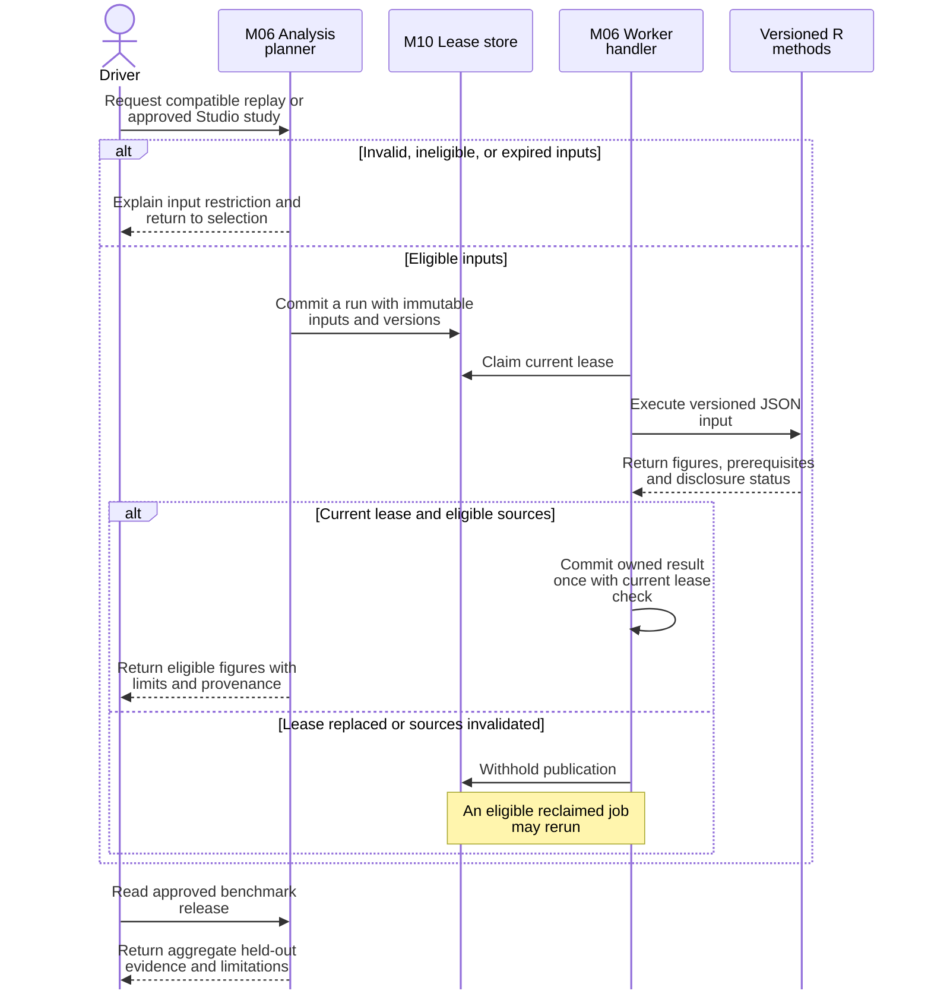

Only reference-labeled replay supports accuracy claims. Studio can expose descriptive output when inference is ineligible, subject to disclosure checks including complementary suppression. Approved aggregate exports follow the same checks as the result view. [TRD §5](TRD.md#5-statistical-analysis-and-reports)

### J6. Author through MCP and review a report

An authorized agent starts a report job and retrieves only its approved template and evidence. The driver reviews the resulting frozen snapshot in RAFIQ and can request PDF and DOCX. Report authoring is exclusive to the scoped agent. An invalidated grant blocks in-progress publication. Deletion or expiry of a required source also withdraws the affected report. Review and export recheck ownership and source eligibility. [PRD §§8.6, 8.8](PRD.md) · [TRD §§5–6](TRD.md)

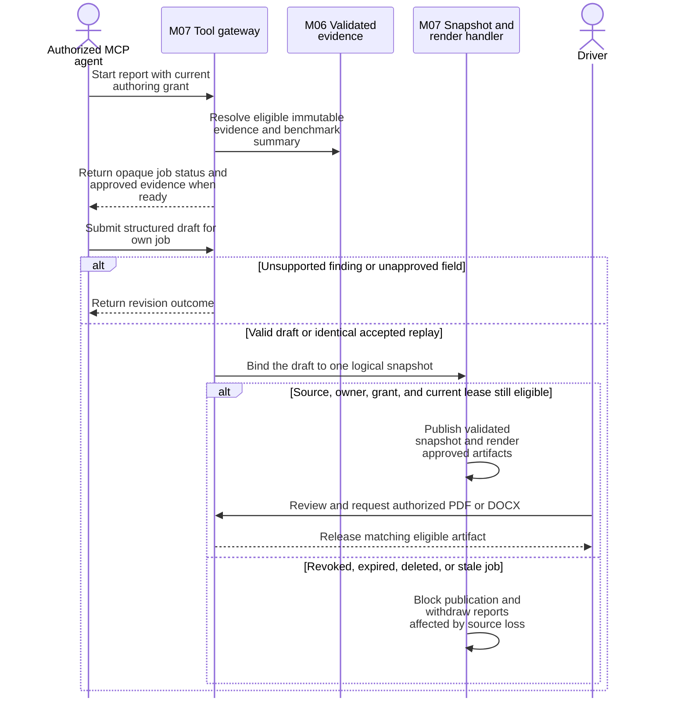

### J7. Ask a temporary chat question

A verified driver links an independently qualified official subscription connection and accepts first-use consent. For each send, the application assembles only relevant current PRD §8.8 context. The conversation is temporary in RAFIQ. [PRD §§8.8–8.9](PRD.md) · [TRD §6](TRD.md#6-external-protocols)

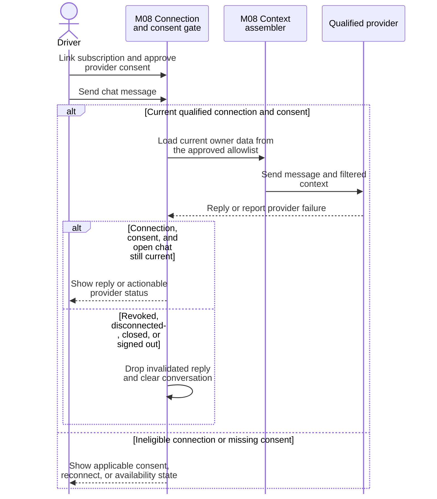

### J8. Operate RAFIQ and support an account

An Owner checks Health, Release Readiness, and disclosure-checked Adoption. A scoped Staff member uses exact lookup and sends eligible account messages or applies restricted lifecycle actions. Distinct contributor checks cover overlapping ranges, subgroup subtraction, and revised releases. Suspend hosted operations immediately, while a configured offline tab can continue local warnings within its existing limits. [PRD FR-22](PRD.md#57-admin-dashboard) · [TRD §7.1](TRD.md#71-admin-dashboard-fr-22)

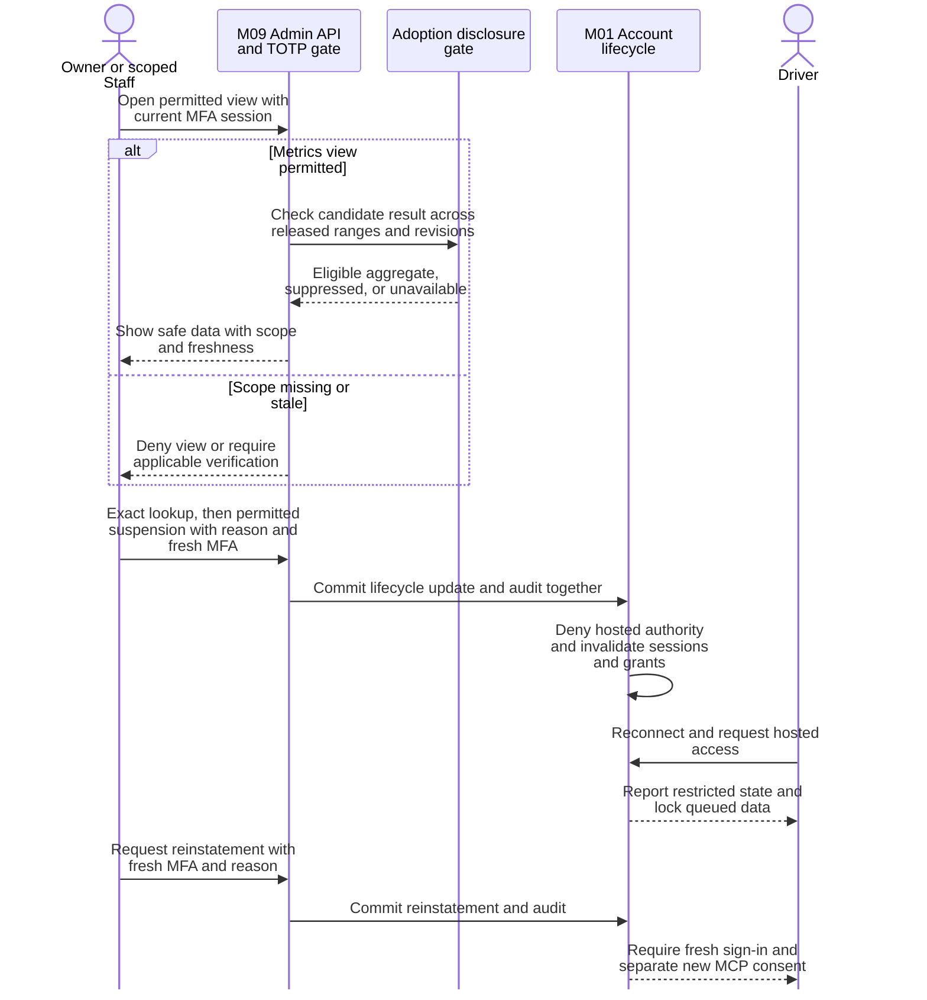

Account Support binds identity messages to the verified account email on the server. It records durable intent and outcome for external messages. Staff invitations are bound and expire. Reused TOTP codes, revoked permissions, and concurrent removal of the last active Owner are checked before sensitive operations. [TRD §7.1](TRD.md#71-admin-dashboard-fr-22)

## 10. Database and Data Architecture

**Confirmed logical requirements.** Supabase PostgreSQL owns structured records, lifecycle, grants, jobs, and validated results. The diagrams below derive from TRD §3. Entity and key names are illustrative. Alembic will establish physical tables, columns, policies, constraints, and indexes. The clip object store holds protected bytes and PostgreSQL holds object eligibility. Export artifact persistence requires its own approved design. [TRD §3](TRD.md#3-logical-database-schema)

### Driver, session, and clip records

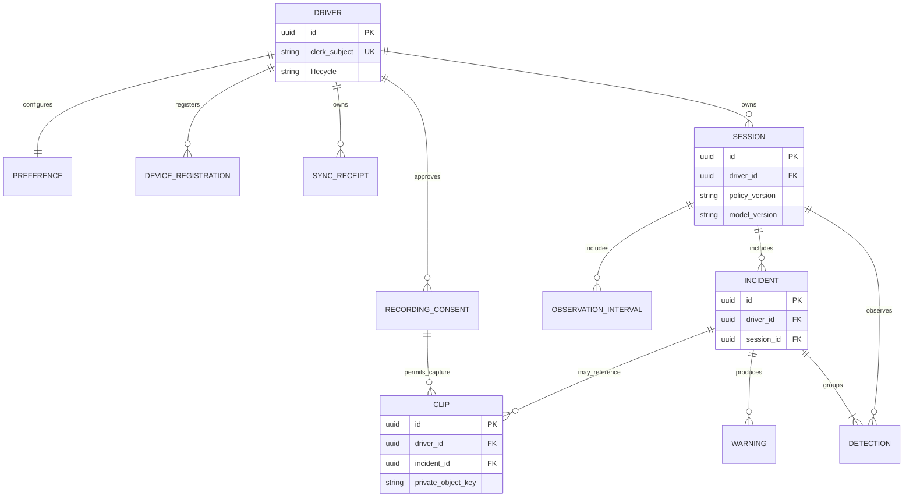

### Emergency records

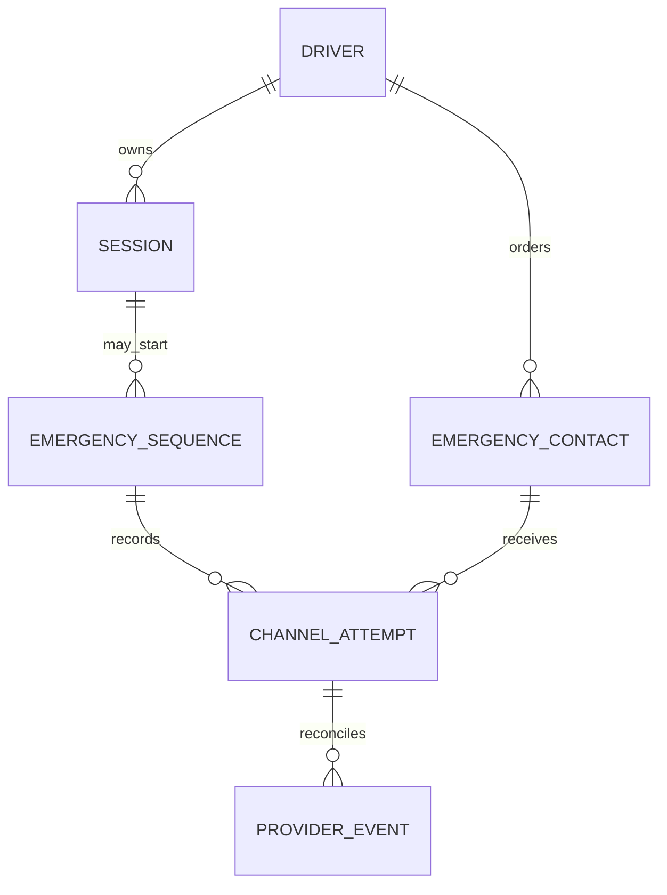

### Analysis, reports, and connections

```mermaid
erDiagram
    DRIVER ||--o{ MCP_GRANT : authorizes
    DRIVER ||--o{ CHAT_CONNECTION : links
    DRIVER o|--o{ ANALYSIS_RUN : owns_private_runs
    DURABLE_JOB o|--o| ANALYSIS_RUN : executes
    STUDY_DATASET o|--o{ ANALYSIS_RUN : supplies_controlled_inputs
    ANALYSIS_RUN ||--o{ ANALYSIS_INPUT : freezes
    ANALYSIS_RUN ||--o| VALIDATED_RESULT : publishes
    STUDY_DATASET ||--o{ BENCHMARK_RELEASE : supports
    DRIVER ||--o{ REPORT : owns
    MCP_GRANT ||--o{ REPORT : initiates
    REPORT ||--|{ REPORT_SOURCE : binds
    REPORT ||--o{ EXPORT_ARTIFACT : renders
```

### Administration records

```mermaid
erDiagram
    direction LR
    ADMIN_PRINCIPAL ||--o{ ADMIN_INVITATION : issues
    ADMIN_PRINCIPAL ||--o{ ADMIN_PERMISSION : holds
    ADMIN_PRINCIPAL ||--o| ADMIN_MFA : enrolls
    ADMIN_PRINCIPAL o|--o{ ADMIN_AUDIT_EVENT : is_actor
```

| Owner | Persistence and relationship rules |
| --- | --- |
| M01 and M03 | Driver records use a unique verified Clerk subject. Driver-owned resources use UUID primary keys and owner foreign keys. Use equivalent composite owner and parent references for sessions, incidents, and clips. Receipts bind owner, stable item ID and accepted content. Index owner/parent and owner/session-time access. |
| M04 and M05 | Clip rows reference source consent and owned incident, and track capture, expiry, size and object state. Contacts are ordered, limited to two, and carry versioned destinations and channel eligibility. Enforce one attempt per sequence, contact, and channel. Deduplicate provider events by provider and event identity. |
| M06 and M07 | Preserve input references and revisions, expected result version, methods and seed, and a single publication per logical run. Reports bind the initiating driver, client and grant, eligible sources and frozen snapshot. Agent read authority and authoring authority are separate. |
| M08 and M09 | Persist encrypted chat credentials and consent separately from transient conversation. Admin records cover principals, invites, grants, MFA, audit, restricted adoption inputs, and disclosure-checked publication revisions. Separate admin records and access roles from driver data. |
| M10 | Keep runnable jobs, lease state and attempts with indexed claim predicates. Store privacy-filtered operational samples and approved evidence references. Maintain deletion and recovery records sufficient to prevent replay or restore from re-exposing data. Each capability owns its business state. |

Read across modules through authorized projections or interface calls. Use a single PostgreSQL transaction for an accepted sync record and receipt, a consumed alert confirmation and attempt claim, a checked publication transition, and a suspension with its audit event. Recheck lifecycle when a long-running or external operation returns. Keep authorization and private data out of shared caches. Reuse current validated analytical results and invalidate them when their eligible inputs change.

| Lifecycle item | Confirmed deadline or behavior |
| --- | --- |
| Queued clip | 24 hours after capture. Revoked recording consent discards unsent clips and blocks pending publication. |
| Hosted clip | Seven days after capture. Deleting it preserves independent incident history and removes the clip reference. |
| Session and incident metadata | 90 days after session end. |
| Precise coordinates | 24 hours after capture. |
| Hosted report | 30 days after creation or earlier loss of a required source. Withdraw dependent reports on source deletion or expiry. |
| Owner-authorized download link | Five minutes, with current authorization and resource eligibility checked at use. |
| Admin audit | Append-only during 90-day retention, subject to the applicable linked-identifier deletion rules. |
| Retained private copies | Deny access immediately on deletion or expiry and purge retained copies, including backups, within 30 days. |

Use versioned Alembic migrations including RLS, key constraints, and index changes. Verify ownership under the runtime role. Apply changes compatibly with the deployed API and worker. Before reopening restored reads, reconcile artifacts and replay deletion, expiry, suspension, and grant revocation. Separate institutional study retention from ordinary private history. Copies already delivered or downloaded remain with their recipient. [PRD §§8.5–8.7](PRD.md) · [TRD §§3–4, 7–7.1](TRD.md)

## 11. Authentication, Authorization, and Security

```mermaid
---
config:
  sequence:
    wrap: true
    actorMargin: 28
    mirrorActors: false
---
sequenceDiagram
    actor U as Driver, admin, or MCP user
    participant C as Clerk
    participant A as FastAPI authority boundary
    participant P as Application policy and PostgreSQL
    U->>C: Sign in or authorize compatible client
    C-->>U: Verified session or scoped opaque OAuth access
    alt Driver request
        U->>A: Present driver session
        A->>P: Resolve verified subject, current eligibility, and owned action
        P->>P: Set trusted owner context for this transaction and enforce RLS
    else Staff or Owner request
        U->>A: Present verified session and complete TOTP challenge
        A->>P: Verify active grant, session-bound MFA, and fresh proof when required
        P->>P: Use narrow admin operation and audit policy
    else MCP tool request
        U->>A: Present scoped access from CIMD and S256 PKCE flow
        A->>C: Verify opaque token status and audience
        A->>P: Check current driver, client, grant, scope, and resource eligibility
    end
    alt Authority and action checks pass
        A-->>U: Serve allowed response
    else Invalid, revoked, expired, or out of scope
        A-->>U: Deny with safe access state
    end
```

Clerk authenticates the identity. FastAPI authorizes each action and class of caller. Verify issuer, expiry, audience, and token or session status as applicable. Independently reinforce the owner boundary in PostgreSQL with least-privilege RLS and transaction-local context. Use separate migration and restricted worker privileges. Validate media and download authorization even for previously issued links. Check current ownership, consent, and source state at each private boundary. [TRD §4](TRD.md#4-authentication-authorization-and-security)

| Threat or failure | Enforcement |
| --- | --- |
| Cross-account references or stale pooled database context | Resolve identity server-side, use owner-aware foreign keys and transaction-local RLS, isolate roles, and exercise account switching and direct requests. |
| Stolen or stale file reference | Check current owner, lifecycle and source eligibility on every applicable range or export request. Keep object keys, bucket credentials, and reusable provider URLs behind FastAPI. |
| Cached or copied browser queue | Use a random driver/device key, persist only its wrapped form alongside ciphertext, and clear its usable form and decrypted state on sign-out. Require same eligible driver for recovery. |
| Revoked OAuth grant, report linkage, or chat consent | Recheck current grant and source at each operation and release. Restrict contexts to the approved allowlist. End or discard invalidated chat response and conversation state. |
| Staff privilege escalation or support misuse | Use the invitation-bound admin principal, current scoped grant, encrypted TOTP secret, session binding, replay rejection, re-verification and an independent audit trail. Store recovery codes hashed and single-use. Serialize last-Owner changes and audit deployment recovery. |
| Forged, duplicate, or stale alert activity | Verify webhook authenticity using the provider contract, deduplicate events, and require a fresh bound confirmation and unique claim before every send. |
| Correlation or disclosure through metrics and logs | Allowlist operational metadata and enforce disclosure checks at publication and read time. Keep tokens, videos, precise location, contact data, raw measurements, prompts, and report content out of logs. |

Use HTTPS, encrypted private storage, server-side credentials, and separate secrets for development, preview, and production. Grant privileged access only to the process that requires it. Protect app and provider callbacks with their own verification material. Require both account-support and suspension permissions for a staff member to suspend or reinstate an account, with fresh verification and an approved reason. [PRD FR-02 and FR-22](PRD.md) · [TRD §§4, 6–7.1](TRD.md)

## 12. External Integrations

```mermaid
flowchart LR
    Identity["M01 Accounts and M07 MCP"] <-->|Session verification and scoped OAuth| Clerk["Clerk"]
    Admin["M09 Administration"] <-->|Verified identity and eligible account messages| Clerk
    Clerk <-->|Qualified social sign-in| Social["Google and Apple"]
    Media["M04 Clips"] <-->|Private HTTPS object operations| Neon["Neon pilot candidate"]
    Emergency["M05 Emergency Mode"] -->|Attempted email| Email["Resend"]
    Emergency -->|Attempted WhatsApp message via PyWa| WA["WhatsApp Cloud API"]
    Email & WA -->|Signed delivery updates| Emergency
    Chat["M08 Optional Chat"] <-->|Approved context and response| Provider["Qualified subscription provider"]
    Web["Next.js"] -->|Frontend hosting| Vercel["Vercel"]
    Platform["M10 Platform Operations"] <-->|TLS PostgreSQL| DB["Supabase"]
    Platform -->|Encrypted recovery stream| Destination["Independent destination · open"]
```

| Integration and owner | Interface, data, and credentials | Failure and fallback |
| --- | --- | --- |
| Clerk, M01/M07/M09 | Verified sessions, account lifecycle, identity messages, and CIMD OAuth. Qualify production domain, server credentials, callback configuration, protected resource metadata, scopes and revocation. Authenticate configured Clerk webhooks using the raw body and signing material. Google and Apple have independent setup and evidence. | Identity failure blocks affected hosted access. Verified email/password is the baseline. Activate each social option after production checks and budget qualification. Owner recovery follows the admin procedure. |
| Supabase PostgreSQL, M10 | SQLAlchemy and psycopg over TLS, separate roles and credentials for API, worker and migration. Stores authoritative private structured data, jobs, grants and results. | Keep committed receipts durable, retain eligible pending browser data, recover jobs through leases, and follow independent restore. Qualify row growth, load, quotas and recovery under zero-cost limits. |
| Neon object storage, M04 | Pilot candidate for private signed S3-compatible requests through boto3. Transfers consented clip bytes through FastAPI. Bucket credentials stay server-side. | Partial transfers remain private. Retry eligible stable-ID upload and reconcile orphans. Qualify capacity, transfer, range reads, deletion and restore integration before rollout. |
| Resend Free, M05 | Server API key, verified sending domain, fixed alert and applicable location, signed webhook evidence. Use test events before live qualification. | Record acceptance separately from delivery. Claim once per eligible channel. Preserve uncertain state and apply the shared contact fallback rule. |
| WhatsApp Business Platform, M05 | PyWa adapter to the official Cloud API. Requires test and production credentials, signed callbacks, approved template, documented off-app opt-in and honored opt-out. | Gate WhatsApp independently on eligibility, delivery and zero cost. Qualified email can operate independently. |
| ChatGPT or Claude subscription integration, M08 | Official provider linking and inference for eligible account, encrypted connection credentials, messages and §8.8 data allowlist. | Each provider requires qualification. ChatGPT requires program participation. Claude remains a future option pending an official consumer subscription route. Surface provider unavailability or exhausted allowance without blocking public signup. |
| Vercel, M10 and frontend | Hosted Next.js, isolated preview and production configuration, frontend identity configuration. | Measure deployment fit and actual zero-cost eligibility. A Vercel address supports the demo path. Production identity and live email have their own domain requirements. |
| Independent recovery destination, M10 | Encrypted backups and ordered log outside the primary failure domain. Requires access controls and recovery key procedure. | Select and qualify a zero-charge destination and exercise restore, deletion and key recovery before public activation. |

Use timeout and retry settings that respect the operation and provider contract. Apply the emergency deadline and one application attempt per contact channel. Use bounded retry and clear status for transient media and eligible job failures. Exact quotas, permitted use, timeouts, and recovery behavior for the deployed accounts are qualification evidence. The TRD records provider references, configuration constraints, and test procedures. [TRD §§1, 4, 6–8](TRD.md)

## 13. Deployment and Infrastructure Architecture

```mermaid
flowchart TB
    Browser["Driver and admin browsers"] -->|HTTPS| Vercel["Vercel Next.js"]
    Browser -->|Authorized HTTPS| API["FastAPI<br/>Public host pending"]
    MCP["Compatible MCP client"] -->|Scoped HTTPS| API
    Browser -->|Identity| Clerk["Clerk deployment"]
    subgraph Compute["Hosted application runtime"]
        API
        Worker["Python worker<br/>Pinned R and render dependencies"]
    end
    API <-->|TLS PostgreSQL| PG[("Supabase PostgreSQL")]
    Worker <-->|Claims, results, and expiry work| PG
    API <-->|Private object I/O| Clips[("Private storage<br/>Neon pilot candidate")]
    API <-->|HTTPS| Providers["Delivery and chat providers"]
    PG -->|Encrypted backups and log| Recovery[("Recovery destination · open")]
    Clips -.->|Reconcile on restore| Recovery
    API & Worker -->|Filtered telemetry| Health["Operational and admin health"]
```

| Environment | Runtime and release conditions |
| --- | --- |
| Development | Run the frontend, API, worker, and R with versioned fixtures and isolated development credentials. Restore `package-lock.json`, `uv.lock`, and `renv.lock` during implementation and record runtime, image, model, ONNX and WebAssembly details in reproducible-build evidence. |
| Preview and validation | Use isolated configuration for previews. For shared Phase 0 HTTPS validation, use Vercel Hobby for the browser and Render Free for FastAPI. The attended local Python/R worker claims jobs from isolated Supabase PostgreSQL over TLS and has no inbound listener. Use separate validation credentials, grants, Clerk development identities, webhook settings and storage namespaces. Verify compatible migrations, browser-to-API connectivity and synthetic fixture processing. [Phase 0 hosting runbook](PHASE_0_HOSTING.md) |
| Campus demo, 15 December 2026 | Target a stationary warning, camera pause, and summary with benchmark and gate evidence. Reuse the isolated hosted validation setup after rehearsal. Keep the full local fixture available for an attended fallback. Test interruption and job recovery. |
| Public | Qualify always-on API and worker hosting, the selected Vercel frontend, production identity, Supabase, private media capacity, and independent recovery at zero project cost. Oracle Always Free is a hosting candidate. Keep a failed gate open with the measured result and its original target. |

```mermaid
flowchart TB
    Change["Change and review"] --> CI["Build locks, tests, contracts, compatibility"]
    CI --> Preview["Isolated preview or validation"]
    Preview --> Verify["Smoke, migration rehearsal, and evidence"]
    Verify --> Signoff{"Applicable release approval?"}
    Signoff -->|Pending or failed| Hold["Hold affected rollout and record evidence"]
    Signoff -->|Approved| Release["Apply compatible migration and deploy matching API and worker"]
    Release --> Smoke{"Production health and smoke pass?"}
    Smoke -->|Yes| Observe["Monitor service and capability gates"]
    Smoke -->|No| Rollback["Roll back compatible versions or restore in isolation"]
    Rollback --> Verify
```

The CI/CD sequence is **Proposed**. Before approval, record exact deployed builds, workload, tested device and models, results, and release evidence. Health checks cover frontend/API availability, API latency, worker backlog, uploads and sync, storage quota, backup lag, purge, and channel outcomes. Test rollback with retained records. Recovery replays the independently recoverable log, reconciles object and job state, reapplies current deletion and authorization rules, and suppresses historical emergency sends before re-enabling reads.

Public release requires production identity, the public journey, core and applicable feature evidence, device and benchmark performance, privacy and lifecycle, accessibility, public load and recovery, client-neutral MCP and reports, and both admin acceptance areas. Social sign-in, each live alert channel, and each optional chat provider have independent gates. Ali Sameh owns release approval. [PRD §8](PRD.md#8-planning-decisions-and-release-gates) · [TRD §§7–8](TRD.md)

## 14. Non-Functional Architecture

These are **Confirmed targets and release checks**. Each measurement must record the build, environment, workload, percentile or maximum, and observed value. Provider quotas, hardware performance, and recovery timing require qualification on the deployed setup.

| Requirement | Measurable target or evidence | Design response and owner |
| --- | --- | --- |
| NFR-01 Supported setup | Current and previous patched Chrome major on Windows 11 x64. Verify a 30-minute CPU-only session at four logical cores, 8 GB RAM, and a built-in 720p/30 fps camera. | M02 verifies media, assets and readiness before enabling Start. Qualify the exact model, browser build, and assets. |
| NFR-02 Responsiveness and capacity | At 20 initial or 100 public concurrent signed-in users, dashboard p95 ≤3 s or ≤2 s respectively. Exercise 5 or 20 concurrent uploads and 250 or 500 MB per driver. At least 95% of supported ≤20 MB uploads complete within 60 s at 5 Mbps. | M06 publishes reusable validated results, M04 bounds and authorizes media, and M10 measures the API path, worker and database. Budget clip transfer independently of concurrent request load. |
| NFR-03 Availability and recovery | ≥99% hosted availability over seven days, usable service within 15 minutes on controlled restart, and ≤5 minutes of hosted data loss during the disaster drill. A configured open tab handles 30 continuous offline minutes and resumes eligible sync with zero missing or duplicate durable records. | M02–M04 decouple local warnings, encrypted queue, and clip sync. M10 qualifies independent recovery, lease reclaim and deletion-safe restore. |
| NFR-04 Accessibility | Pass the keyboard and screen-reader workflow checklist and keep warnings distinguishable without color or audio. | Browser layouts and feature owners provide focus, text equivalents, clear announcements and selectable chart and timeline values. |
| NFR-05 Private data handling | Zero unauthorized records, bytes, or reports released in isolation, expiry, revocation, and race fixtures. Immediate access denial on expiry or deletion, with purge within 30 days. | M01 and all private owners check current authority, scope and lifecycle. M10 verifies cleanup and restore. |
| NFR-06 Operating constraints | Stationary readiness and acknowledgment by drivers, approved delegated supervisor controls in motion, camera pause and manual resume, and zero unintended alerts in controlled invalidation fixtures. | M02 and M05 qualify the operating procedure and browser cue policy. Fresh online confirmation and unique attempt claims protect dispatch. |
| SM-01–05 and FR-15 | 10 of 12 eligible participants finish the unassisted public journey within the specified test window. Score class precision and recall by PRD §8.3. Target ≤2 false warnings/hour, p95 ≤750 ms from qualification to visible warning, and ≥90% overall coverage in supported normal conditions. For repeated analysis, require exact counts and absolute error ≤0.000001 for unrounded results. | M01–M03 and M06 collect journey and held-out evidence. Freeze the catalog, policy and scoring setup before scoring, and pin inputs, methods and seeds for reproducibility. |

**Resource assumptions to verify.** The TRD’s pilot clip sizing allows up to 3 GB for 12 drivers at 250 MB each, while 100 drivers fully provisioned at 500 MB could require 50 GB before overhead. Neither sizing scenario proves transfer or performance capacity. Measure 90-day retained observations and indexes, capacity and expiry, restore lag, and hard spend behavior using the qualified accounts. Hold the affected rollout if the zero-cost service cannot meet its target. A single product API and database simplify transactionality and support maintenance. The shared runtime makes media throughput, query plans, and job backlog important capacity limits. [PRD §§6–8](PRD.md) · [TRD §§7–8](TRD.md)

## 15. Testing and Observability Architecture

| Test boundary | Responsibility and evidence |
| --- | --- |
| Unit and fixture | M02 clocks, overlapping warning rules, camera loss and fresh resume. M03 queue and stable replay. M04 capture limits. M05 expiry and cancellation. M06–M07 deterministic results, disclosure, evidence validation and export parity. M09 permission, freshness and suppression policies. |
| Database and adapters | Exercise real transactions and RLS with a least-privilege role, owner-aware keys, duplicate receipts, partial upload and deletion, current-lease-only publication, signed callback deduplication, and role isolation. Run a provider-specific fixture or controlled account test before qualification. |
| API contracts | Check versioned REST batches and per-item outcomes, authorization on byte ranges, safe private errors, client-neutral MCP scopes and token refresh, stale report drafts and grants, and narrow admin responses. |
| End-to-end and accessibility | Exercise J1–J8 with isolated accounts and data. Cover first-time and returning sign-in, permitted supervised controls, failed camera setup, offline recovery, pending and unavailable results, consent and deletion, MFA and recovery, and screen-reader and keyboard operation. |
| Security and lifecycle | Test two drivers, an Owner, differently scoped Staff, and authorized and revoked clients. Include direct references, different browser accounts, consent withdrawal, revoke during generation, duplicate attempt after interruption, deletion and expiry during upload or restore, and inferable small adoption groups. |
| Load, resilience and release | Measure device and public load at the TRD targets. Rehearse process restart, job reclaim, independent backup restoration, quota exhaustion, and rollback using synthetic or approved test data. Verify deployed gates and exact reproducible versions. |

**Proposed instrumentation.** Use structured request, job, sync and provider outcome events with allowlisted correlation IDs, durations, counts, and coarse failure classes. Correlate a request and its logical job without collecting private payloads. Collect health samples with time window, units, last update, and denominator. Alert on stale samples, rising errors or latency, oldest pending job, stuck sync, storage and transfer limits, recovery lag, overdue purge, and channel failures. Keep operational telemetry separate from protected admin audit and restricted adoption inputs.

Service Health distinguishes fresh zero, a confirmed outage, Unknown when samples are missing or stale, and pending qualification. Adoption distinguishes incomplete input, unavailable results, and disclosure suppression. Count emergency attempts by recorded channel status and keep accepted separate from delivered. Set signal thresholds against the applicable release target or approved budget and qualify them before launch. [TRD §§7.1–8](TRD.md)

## 16. Project Structure and Module Mapping

**Existing planning sources.** [PRD](PRD.md), [TRD](TRD.md), [EXPERIENCE](EXPERIENCE.md), [DESIGN](DESIGN.md), and [API](API.md). Historical planning artifacts remain available in the [archived Git revision](https://github.com/alisameh05/RAFIQ/tree/4923de79cb4c4b6a166091d0f3ef53a05a71ddfb/docs/planning-artifacts).

**Proposed application paths:**

```text
web/                            Next.js application and browser tests
  src/
    app/                        App Router layouts and page composition
    ui/                         Shared navigation, forms, focus, and feedback
    features/
      accounts/                 M01 account and onboarding UI
      monitoring/               M02 readiness, local policy, and controls
      session_records/          M03 encrypted queue, sync, and history UI
      clips/                    M04 capture and replay UI
      emergency/                M05 local eligibility and channel state UI
      analytics/                M06 personal, study, and benchmark UI
      reports/                  M07 reporting and MCP connection UI
      chat/                     M08 provider connection and temporary chat UI
      admin/                    M09 separate administration UI
  tests/                        Browser workflow and accessibility fixtures
server/                         Python application and R environment
  rafiq/
    api/                        FastAPI transport and shared composition
    accounts/                   M01 identity, access, and account lifecycle
    session_records/            M03 key gate, ingestion, receipts, and history
    clips/                      M04 consent, upload, and private gateway
    emergency/                  M05 destination, attempt, and callback policy
    analytics/                  M06 input preparation and validated results
    reports_mcp/                M07 grants, tools, drafts, and export
    chat/                       M08 provider authorization and context
    admin/                      M09 MFA, views, account support, and audit
    platform/                   M10 configuration, database, and telemetry
    worker/                     M10 lease runner and handler registration
  r/
    analytics/                  M06 versioned statistical and scoring methods
    adoption/                   M09 adoption methods, using the R contract
  migrations/                   M10 Alembic schema, policies, and indexes
  tests/                        API, persistence, worker, and contract fixtures
ops/                            M10 deployment and recovery procedures
```

Place provider adapters near their owner and introduce internal folders only when there are several related components. Keep browser and backend contract fixtures versioned with the producing module. Use the TRD’s lockfile and image pinning baseline at build time. [TRD §1.1](TRD.md#11-runtime-and-dependency-baseline)

## 17. Architectural Decisions and Trade-offs

| Decision and status | Context, alternatives, and consequence |
| --- | --- |
| AD-1 Local monitoring · **Confirmed** | Local CPU inference keeps the warning loop available during disconnect. The selected v1 pipeline adapts Driver Monitor with pretrained MediaPipe landmarks and NanoDet. RAFIQ applies and calibrates behavior rules. The exact pinned bundle and supported laptop still require qualification. |
| AD-2 Driver ownership · **Confirmed** | Clerk supplies identity. FastAPI and RLS apply current action and owner rules. Central identity alone would leave private resources dependent on application paths applying ownership consistently. Explicit owner references and role tests are required. |
| AD-3 Offline synchronization · **Confirmed** | The encrypted, owner-bound queue and stable receipts support reconnect and replay. Whole-batch acknowledgement would hide uncertain item outcomes. Unavailable or interrupted state is visible and recovery needs same-driver online eligibility. |
| AD-4 Data and media authority · **Confirmed** | PostgreSQL tracks eligibility and FastAPI gates private bytes. Public object URLs would bypass current authorization. Proxying media through FastAPI makes upload, range response and quota qualification important. |
| AD-5 Statistical authority · **Confirmed** | R computes shared results through a leased Python worker. Per-surface calculations or request-bound jobs would duplicate metrics or couple latency to cost. Persist provenance, bounded inputs and fenced outputs. |
| AD-6 Report and MCP release · **Confirmed** | Scoped agent authoring supplies evidence-linked drafts, and RAFIQ validates and freezes the snapshot. Raw model output or broad browser authoring would weaken the accepted workflow and evidence checks. Qualify client-neutral OAuth and both export formats. |
| AD-7 Emergency contact alerts · **Confirmed** | Fresh per-channel confirmation and one claimed attempt protect against late or duplicate sends. Automatic retries during uncertain delivery would risk stale alerts. Track provider acceptance, delivery, and expiry separately. |
| AD-8 Deployment and evidence · **Confirmed** | Keep public deployment conditional on capacity, zero charge, and qualified recovery. An attended sleeping service can support a rehearsed demo, while public recovery and availability require a qualified always-on host and independent recovery. |
| AD-9 Optional subscription chat · **Confirmed** | Each provider uses official, consented, subscription-backed access. A common mandatory provider would put private data and core signup behind a separate qualification. Keep provider access and revocation independent. |
| FR-22 Admin separation · **Confirmed** | Dedicated staff policy, least-privilege support, and checked aggregate views support operation with limited data. A general driver-admin interface would expose unrelated private information. Preserve evidence, audited actions, and disclosure checks. |
| Module and folder boundaries · **Proposed** | A capability-based layout aligns code and test ownership with product rules. Page-based ownership would split behavior across entry points. The composition layer and import checks preserve explicit dependencies without adding deployable services. |

The [archived architecture spine](https://github.com/alisameh05/RAFIQ/blob/4923de79cb4c4b6a166091d0f3ef53a05a71ddfb/docs/planning-artifacts/architecture/architecture-RAFIQ-2026-11-20/ARCHITECTURE-SPINE.md) records the earlier AD-1–AD-8, including the initial Codex-specific MCP and email-only design. This section incorporates the later client-neutral MCP, channel-specific emergency delivery and optional chat decisions. The [TRD](TRD.md) governs technical behavior and qualification, and the [API specification](API.md) defines the proposed wire contract.

## 18. Extensibility and Future Evolution

- Add behavior classes through the versioned catalog, observation contract, annotation guide, calibration, and held-out scoring gates. Carry model and policy versions through history, replay, and analytics before comparing results across versions.
- Add approved statistics, studies, or report templates through versioned R inputs and outputs, validated result contracts, and existing review, lifecycle, and disclosure controls. Extend provider integrations through narrow capability adapters and independent qualification.
- Grow media and worker capacity after measuring gateway transfer, sync rates, database retention and indexes, runtime limits, and job latency. Use the current module contracts to change storage or hosting once an approved provider passes the same tests.
- Keep deployments coordinated while a shared database and worker can meet the evidence targets. If a measured bottleneck later requires isolated compute, use the leased job and versioned result contracts as the boundary. Review cost, consistency, and operational burden before changing independently deployable units.

## 19. Architecture Verification Checklist

### Requirement traceability

| Requirement | Primary owner | Flow or acceptance anchor |
| --- | --- | --- |
| FR-01 Public account access and recovery | M01 | J1, AC-01, SM-01 |
| FR-02 Driver data isolation | M01 | §11 and AC-02 across J2, J6, J7, J8 |
| FR-03 Profile and settings | M01 with M02, M04, M05 | §6 Settings, J1–J3 and AC-03 |
| FR-04 Session readiness and lifecycle | M02 | J1, J3 and AC-04 |
| FR-05 Observe and show driver state | M02 | J1, AC-05 and held-out behavior evidence |
| FR-06 Handle unreliable observation | M02 | J1, J3 and AC-06 |
| FR-07 Warn and explain | M02 | J1, J3 and AC-07 |
| FR-08 Continue a configured session offline | M03 with M02 | J2 and AC-08 |
| FR-09 Control entry and cancellation | M05 | J3 and AC-09 |
| FR-10 Send emergency message and location | M05 | J3 and AC-10 |
| FR-11 Preserve session observations | M03 | J1, J2, J4 and AC-11 |
| FR-12 Record consented, bounded clips | M04 | J1, J2 and AC-12 |
| FR-13 Review, expire, and delete data | M03 with M01, M04, M07 | J2, J6, §10 and AC-13 |
| FR-14 Analyze personal driving sessions | M06 | J4 and AC-14 |
| FR-15 Show reproducible statistical results | M06 | J5 and AC-15 |
| FR-16 Run What-If simulations | M06 | J5 and AC-16 |
| FR-17 Run controlled experiments | M06 | J5 and AC-17 |
| FR-18 Measure and publish detection performance | M06 | J5, AC-18 and SM-02–05 |
| FR-19 Author reports through MCP and review in RAFIQ | M07 | J6 and AC-19 |
| FR-20 Retrieve authorized data and author through MCP | M07 | J6, §11 and AC-20 |
| FR-21 Ask about driving data in RAFIQ | M08 | J7 and AC-21 |
| FR-22 Monitor RAFIQ and support accounts | M09 | J8 and AC-22 metrics and actions |
| NFR-01 Supported setup | M02 | J1 and §14 device evidence |
| NFR-02 Responsiveness and capacity | M10 with M04, M06 | §14 public and initial load evidence |
| NFR-03 Availability and recovery | M10 with M02, M03 | J2, §§13–14 and restore drill |
| NFR-04 Accessibility | Browser feature owners | §6 and §15 workflow checks |
| NFR-05 Private data handling | M01 and private record owners | J2, J6–J8, §§10–11 and §15 isolation and lifecycle tests |
| NFR-06 Operating constraints | M02 and M05 | J1, J3 and §14 supervised-use evidence |

Acceptance definitions and the exact release evidence remain in the [PRD](PRD.md) and [TRD §8](TRD.md#8-measurable-acceptance-and-release-gates).

### Open questions and approval evidence

| Open question | Evidence or decision needed |
| --- | --- |
| Always-on compute, frontend plan, and production identity | Approve the public host after availability, recovery, worker interruption, and capacity tests. Confirm Vercel plan eligibility and a controlled production identity domain at zero project cost. |
| Private media, report artifacts, and independent recovery | Qualify pilot and public clip storage separately. Select private handling and retention for export artifacts. Choose a zero-charge independent backup and ordered log destination, approve key recovery, and pass recovery and purge drills. |
| Browser inference and recording | Verify source and redistribution terms, package and hash the selected MediaPipe and NanoDet assets, and qualify the bundle on the reference laptop. Freeze the catalog, annotation guide, and scoring protocol before held-out testing. Qualify WebM/VP8 recording separately. |
| Supervised use, emergency channels, and social connections | Approve the supervised procedure, timing and drowsiness evidence, sender domain, WhatsApp opt-in/template/delivery and cost, and each live channel separately. Record independent production Google and Apple identity evidence and Apple zero-cost eligibility. |
| MCP and optional chat | Record the deployed MCP revision and client-neutral scope, revocation and authoring checks. Qualify official subscription access, consent, privacy and zero project cost for each optional chat provider. |
| Implementation and design handoff | Review the proposed [API wire contracts](API.md), measurement cadence and size bound, adoption publication units and freshness thresholds, and Studio aggregate export format. Confirm the proposed module layout and RAFIQ-specific chart, warning and focus treatments during implementation handoff. |

### Document checks

- [x] All 22 functional and six non-functional requirements map to an owner and an acceptance or workflow anchor.
- [x] Modules identify purpose, components, interfaces, ownership, dependencies, security, and failure behavior.
- [x] Dependency directions are explicit and acyclic. Browser and hosted components have clear runtimes.
- [x] Eight core workflows and authentication have sequence views with applicable success and failure states.
- [x] Data ownership, logical relationships, trust boundaries, and integration contracts are documented.
- [x] Deployment, CI/CD, recovery, test ownership, and qualification align with the technical and product requirements.
- [x] Adopted requirements, proposed design, and unresolved qualification are identified.
- [x] All 26 Mermaid blocks render successfully with Mermaid CLI 11.12.0.
