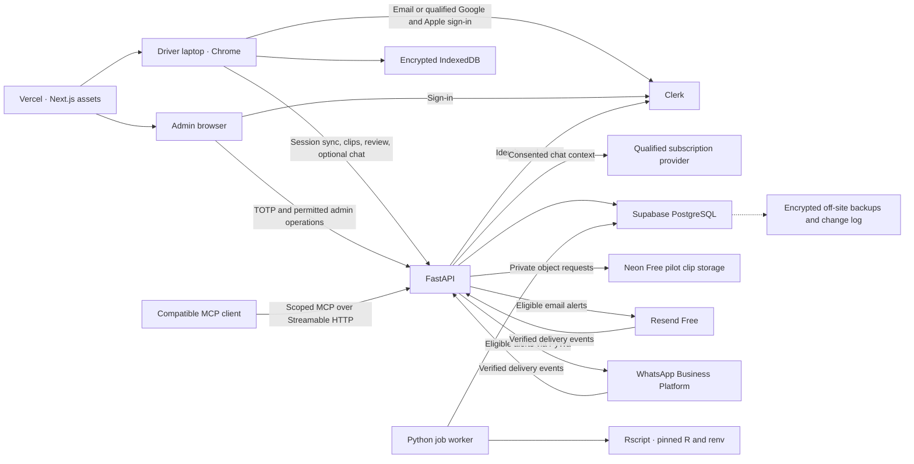

# RAFIQ technical requirements

**Engineering baseline · 20 November 2026 · Release owner: Ali Sameh**

RAFIQ runs live driver monitoring on a laptop and hosts each driver’s private session history, clips, analytics, and reports. A configured session must keep issuing local warnings throughout a 30-minute network outage while its monitoring tab remains open. The public release includes an internal dashboard for the RAFIQ team. Hosted services must operate at zero project cost. The first delivery milestone is a stationary campus demonstration and evidence packet on **15 December 2026**.

The [published PRD](PRD.md) governs product scope, operating conditions, thresholds, and release approval. The [architecture spine](planning-artifacts/architecture/architecture-RAFIQ-2026-11-20/ARCHITECTURE-SPINE.md) and its [decision record](planning-artifacts/architecture/architecture-RAFIQ-2026-11-20/.memlog.md) establish the architecture baseline. This TRD incorporates the subsequent technical review decisions and defines component contracts, the logical schema, and acceptance tests. Section 1.1 records the direct dependency baseline. Reproducible builds, model weights, Pen.dev chart dependencies, provider qualification, and measured performance remain pending.

## 1. System and technology stack

The hosted application is a **modular monolith**. FastAPI owns the product API and private resource access. A separate Python worker executes durable jobs from the same application. The browser owns the camera, observation clock, live behavior policy, and warnings. The worker uses NumPy and pandas to validate, clean, and reshape authorized analysis inputs. **R computes every published statistical result**, including descriptive statistics, simulation results, and benchmark metrics.

| Component | Responsibility and boundary |
|---|---|
| Next.js + TypeScript on Vercel | Camera setup, monitoring and controls, private sync queue, personal dashboard, timeline, experiments, clip replay, report review, optional provider settings and chat, and the separate admin dashboard. Fetch private data through FastAPI. Restrict caches of private responses across sign-out. Vercel is the selected frontend host. |
| Browser vision and recording | Benchmark MediaPipe Tasks Vision landmarks and a small license-compatible model using ONNX Runtime Web on CPU. Evaluate MediaRecorder video-only WebM/VP8. Package and verify the required models and WebAssembly assets before declaring offline readiness. Use Web Crypto with IndexedDB for the encrypted queue. |
| Python + FastAPI | Versioned REST/JSON ingestion, public driver accounts, owner and scope enforcement, session persistence, media gateway, multi-channel emergency dispatch, report validation and access, scoped remote MCP, and outbound requests for optional chat. Keep storage credentials, OAuth checks, and provider secrets server-side. |
| Supabase PostgreSQL | Authoritative structured records, jobs, grants, lifecycle state and validated results. SQLAlchemy and psycopg access PostgreSQL. Alembic owns schema migrations, constraints, and RLS policies. |
| Neon Free object storage | Qualify a private Neon bucket for pilot clips. FastAPI accesses Neon's S3-compatible endpoint through boto3. Supabase is authoritative for ownership and object eligibility. Public media requires separate capacity and transfer qualification. |
| Python worker + Rscript | Claim PostgreSQL jobs under leases, prepare authorized inputs with NumPy and pandas, and exchange versioned JSON with R through jsonlite. Store validated R outputs. Restore R packages with renv. |
| Report generation | An authorized MCP agent authors the report. FastAPI validates its structured draft against approved inputs. WeasyPrint produces PDF and python-docx produces Word from the validated snapshot. |
| Identity and external integrations | Clerk handles verified email/password, recovery, Google and Apple sign-in where qualified, and scoped OAuth for MCP clients. FastAPI enforces staff TOTP. Resend handles qualified emergency email and PyWa connects to the official WhatsApp Cloud API. Qualified providers supply subscription-backed inference for optional chat. |

### 1.1 Runtime and dependency baseline

Use these exact direct versions for the first reproducible build. Release metadata and frontend peer requirements were checked on 20 November 2026. Python dependency resolution passed without installation for CPython 3.14.10 targeting Linux x86-64 and ARM64. Build, runtime, and provider integration checks are release evidence under §8.

| Python on CPython 3.14.10 | Exact direct versions |
|---|---|
| API and serving | `fastapi==0.165.0`, `pydantic==2.14.4`, `uvicorn==0.54.0` |
| PostgreSQL | `SQLAlchemy==2.1.9`, `psycopg[binary]==3.3.9`, `alembic==1.20.1` |
| Analysis input preparation | `numpy==2.5.5`, `pandas==3.1.1` |
| Identity, encryption, and TOTP | `clerk-backend-api==7.1.1`, `cryptography==50.0.2`, `pyotp==2.12.1` |
| HTTP, object storage, and messaging | `httpx==0.28.1`, `boto3==1.44.7`, `resend==2.55.0`, `svix==2.10.0`, `pywa==4.5.0` |
| MCP and exports | `mcp==2.3.0`, `weasyprint==70.0`, `python-docx==1.2.0` |
| Development tooling | `pytest==9.2.0`, `uv==0.13.9` |

Use Svix to verify Clerk and Resend webhooks against the raw request body. Pin the Linux image and the Pango, HarfBuzz, and font dependencies required by WeasyPrint. [Python release](https://www.python.org/downloads/release/python-31410/) · [FastAPI release](https://pypi.org/project/fastapi/0.165.0/) · [MCP Python SDK](https://py.sdk.modelcontextprotocol.io/) · [WeasyPrint installation](https://doc.courtbouillon.org/weasyprint/stable/first_steps.html)

| R and Rscript 4.6.2 | Exact direct versions |
|---|---|
| Base statistics and utilities | `base`, `stats`, and `utils` bundled with R 4.6.2 |
| JSON exchange | `jsonlite` 2.0.0 |
| Environment restoration | `renv` 1.3.1 |
| Development tests | `testthat` 3.3.2 |

[R release](https://cran.r-project.org/sources.html) · [jsonlite](https://cran.r-project.org/package=jsonlite) · [renv](https://cran.r-project.org/package=renv) · [testthat](https://cran.r-project.org/package=testthat)

| Next.js on Node.js 24.22.3 LTS and npm 11.19.1 | Exact direct versions |
|---|---|
| App Router and identity | `next@16.4.6`, `react@19.3.1`, `react-dom@19.3.1`, `@clerk/nextjs@7.10.6` |
| Browser vision and offline queue | `@mediapipe/tasks-vision@1.2.3`, `onnxruntime-web@1.31.1`, `idb@8.0.4` |
| Type checking and lint | `typescript@6.0.3`, `@types/node@24.19.2`, `@types/react@19.3.0`, `@types/react-dom@19.3.0`, `eslint@9.39.5`, `eslint-config-next@16.4.6` |
| Browser and accessibility tests | `@playwright/test@1.65.1`, `@axe-core/playwright@4.14.0` |

Pin Node and npm for local development and CI. Set Vercel to Node.js 24.x and record the hosted patch in release evidence. During chart implementation, use the supplied Pen.dev design and its library information to select and pin chart dependencies. Define the dashboard API and R result contracts independently of the chart renderer. Commit `uv.lock`, `renv.lock`, and `package-lock.json` to record transitive versions. Record model and WebAssembly hashes after qualification. [Node.js release](https://nodejs.org/en/blog/release/v24.22.3/) · [Vercel Node.js versions](https://vercel.com/docs/functions/runtimes/node-js/node-js-versions) · [Next.js package metadata](https://registry.npmjs.org/next/16.4.6) · [TypeScript ESLint peer requirements](https://registry.npmjs.org/typescript-eslint/8.73.0)

## 2. Session, recording, and offline contracts

**Start and observe (FR-04–08).** A driver with a verified, active public account starts while stationary after camera, offline-asset, and consent checks. Check current account eligibility and acceptance of the controlled-use conditions online before starting a new session. Declining recording still permits monitoring. An active browser session evaluates every enabled class in the versioned behavior catalog and retains overlapping labels and times. One incident groups overlapping detections, and one combined warning explains the cues and durations. Qualifying duration, stronger warnings, allowed gaps, recovery, and cooldown use the versioned release policy in PRD §8.3. Acknowledgment preserves the observations. Camera loss, poor light, obstruction, or unreliable observation takes precedence over a warning, marks the interval, pauses monitoring, and clears emergency timers. Restored camera readiness plus manual resume starts fresh qualification.

**Record (FR-12).** Start an in-memory pre-event buffer only within the driver’s recording consent. Match the enabled categories, use three seconds before and after by default, and allow 0–5 seconds at each end. Retain the first bounded segment, cap it at 30 seconds and 20 MB, and indicate truncation. Discard unused context. Request camera video only. At queue or storage exhaustion, show the clip as unavailable and continue monitoring and warnings.

**Keep offline data private (AD-3).** Generate a random data key per driver and device. IndexedDB holds ciphertext and the wrapped form of the key. Only the configured session holds its usable key in memory. On sign-out, stop private processing, clear keys and decrypted UI state across open tabs, and lock the queue. The backend must verify the same eligible driver before unwrapping the device key after reconnect. A configured, signed-in session continues monitoring during network loss while the monitoring tab stays open. Closing, reloading, or crashing the tab ends live monitoring and leaves committed ciphertext available for the same driver's next eligible online sign-in. Expire queued clips 24 hours after capture. Revoking recording consent discards unsent clips and prevents a pending transfer from becoming available.

**Synchronize (FR-08, FR-11–13).** Assign stable UUIDs before enqueueing. Each versioned batch identifies the session, individual event IDs, elapsed session times, and observation or policy versions needed for replay. Preserve capture time separately for retention. The server derives the owner from authentication and checks each event’s parent, lifecycle, and identity. Return per-item acknowledgments after durable commit. Identical retries acknowledge the original write. Conflicting reuse of an ID is rejected. A partial batch or lost response can be retried without duplicating records. Retain pending items until acknowledged, permanently ineligible, or expired under their retention rule. After eligible online recovery of an interrupted session, finalize it at the last durably recorded observation. Starting another session requires fresh readiness checks. Summary availability follows successful sync of its required data.

**Upload and replay (AD-4).** Upload clip bytes separately through FastAPI. Check consent, ownership, source incident, age, size and quota at admission and again before making the object available. A retry reuses the clip ID. Interrupted transfers stay private and orphaned bytes are purged. Deletion and expiry win races with finalization or retry. For playback and export, FastAPI authorizes each request, including byte ranges, and streams eligible bytes. Private bucket credentials and reusable provider URLs stay server-side. The UI distinguishes pending, available, and unavailable media.

## 3. Logical database schema

The following relations describe the required keys, relationships and lifecycle facts. Names illustrate the logical model. Alembic migrations establish physical columns and indexes during implementation. Driver-owned entities use UUID primary keys and a driver foreign key. A unique Clerk subject maps to one driver. For nested private resources, composite references such as `(driver_id, session_id)` must match the parent’s unique owner/ID pair. Apply equivalent constraints at the incident and clip levels so an owned row cannot reference another owner’s parent.

| Relation or related records | Keys, fields, and cardinality |
|---|---|
| Driver, preferences, device key | Driver has a unique Clerk subject, email verification and lifecycle state, versioned controlled-use acceptance, one set of private preferences, and many device registrations. Each registration binds a device identifier and wrapped-key reference to its owner. Clerk manages driver credentials and recovery. |
| Recording consent, emergency contact | A driver has versioned recording consent and up to two ordered contacts. Each contact has a name, email address and/or international-format WhatsApp number. Store destination versions, channel eligibility, applicable WhatsApp opt-in and opt-out, and removal state. Resolve changes before each dispatch. |
| Session, observation interval | One driver has many sessions. A session has start/end, lifecycle, policy/model versions, and many intervals with elapsed bounds, pause cause, feed usability and class observability. Preserve eligible timestamped measurement series for what-if replay. Version the measurement cadence and set a per-session size bound before qualifying the database against the 90-day retention workload. |
| Incident, detection, warning | One session has many incidents and detections. A grouped incident retains its constituent detections with label, elapsed bounds, confidence, and supporting measurements. A warning identifies its incident and qualifying detections, severity, time, and acknowledgment. Store enough linkage to reproduce combined warnings. |
| Clip | A clip identifies its owner, incident, source consent, capture/expiry times, private object key, media type, size, truncation, and availability/deletion state. Deleting a clip preserves independent incident records. Search by session, date, or behavior through the owned incident. |
| Emergency sequence, attempt, provider event | Store eligibility, cancellation, deadline, and terminal state per sequence. Store each attempt by sequence, contact, and channel. Enforce uniqueness across those three fields and deduplicate authenticated provider events by provider and event identity. Precise location has separate permission and expiry. |
| Job, analysis run, result and inputs | Store job owner or controlled evaluation context, job type, input references/versions, lease and attempt state. Link one logical run to validated outputs with method, units, denominators, sample, seed, and version. Persist simulations independently of original measurements. |
| Study dataset, benchmark release | Version approved controlled inputs, driver-disjoint splits, labels, policy and scoring configuration. Persist publishable aggregate results separately. Keep private driver history outside the training and evaluation dataset. |
| Report, report source, export | Bind each job to its owner, initiating MCP client and authoring grant, approved template, and versioned analysis sources. Track job state and draft validation. Bind review and exports to one immutable validated snapshot. Store artifact availability, download authorization, and expiry. |
| MCP grant, sync receipt, deletion and recovery records | Bind grant to driver, client, scopes and revocation. Bind each sync receipt to owner, stable event ID and accepted content. Retain sufficient deletion state to prevent replay or restoration of erased data. Protect recovery records and respect purge deadlines. |
| Chat provider connection and consent | Bind the provider account and first-use consent to the RAFIQ driver. Keep provider credentials encrypted server-side. Store connection and consent status separately from the temporary conversation. |
| Admin identity, invitation, grant, and MFA | Map a verified Clerk identity to an enabled Owner or Staff principal. Store invitation recipient, expiry, and redemption status. Bind Staff grants to the three FR-22 permissions. Store encrypted TOTP enrollment secrets, hashed single-use recovery codes, and server-side verification state tied to the Clerk session. Track revocation and audit sensitive changes. |
| Admin audit event | Record a timestamp, actor, action, outcome, correlation ID and, where applicable, an opaque target reference and approved reason code. Make events append-only during their 90-day retention and restrict the audit reader to Owners. |
| Admin metrics and release gates | Store timestamped operational samples, disclosure-checked anonymous adoption aggregates with publication revisions, and gate status with a verification timestamp and approved evidence reference. Keep any temporary, deduplicated adoption inputs within their source lifecycle. |

Index owner and parent keys used for authorization, owner/session time for history, expiry for cleanup, and runnable/leased job state for workers. Exercise ownership checks with the application database role in integration tests. A migration or database-owner credential would invalidate the RLS test.

## 4. Authentication, authorization, and security

The **driver account is the tenant boundary**. Clerk authenticates. For driver requests, FastAPI verifies the session and maps its subject to a verified driver. For every private operation, the application checks the requested action and current ownership. The database independently applies driver-scoped row-level security. Set trusted driver context within the database transaction and clear it at its boundary so pooled connections cannot retain a previous owner. Use a least-privilege runtime role subject to RLS and separate restricted worker and migration privileges. Browser clients have no direct access path to private database tables or buckets. Staff access follows the separate principal and interface in §7.1.

**Driver sign-in (FR-01–04).** Use Clerk's sign-in, sign-up, and account management components for verified email and password, recovery, and the qualified Google and Apple social connections. Use Clerk's verified user ID as the RAFIQ identity across sign-in methods. Use Clerk's verified account-linking flow when linking an existing account, including a different Apple relay address. Require controlled-use onboarding for every newly registered driver. Enable each social provider separately in each environment after its configuration and end-to-end flow pass.

| Clerk connection | Setup and qualification |
|---|---|
| Email and password | Verify email at signup, support account recovery, and bind the driver record to the verified Clerk subject. |
| Google | Use Clerk's shared credentials in development. For production, configure the Google OAuth web client, Clerk's redirect URI, and the published consent screen. Qualify sign-in with an unrelated external account. [Clerk Google setup](https://clerk.com/docs/guides/configure/auth-strategies/social-connections/google) |
| Apple | Use Clerk's shared credentials in development where available. For production, qualify an eligible App Store app, a web Services ID, Apple signing credentials, redirect URLs, and Private Relay email. Standard Apple Developer Program membership costs USD 99 per year. Verify eligibility for zero-cost access before activation. Email and Google can launch while Apple qualification is pending. [Clerk Apple setup](https://clerk.com/docs/guides/configure/auth-strategies/social-connections/apple) · [Apple web requirements](https://developer.apple.com/documentation/signinwithapple/configuring-your-environment-for-sign-in-with-apple) · [Apple enrollment and fees](https://developer.apple.com/help/account/membership/program-enrollment/) · [Apple fee waiver](https://developer.apple.com/help/account/membership/fee-waivers/) |

| Actor | Permitted surface |
|---|---|
| Verified driver | Self-register through public signup and access own profile, consent, settings, sessions, observations, clips, analytics, reports, and grants. Feature-specific operating conditions apply. |
| Supervisor | Stationary, driver-authorized controls on the driver’s device for that session only: acknowledge warnings, cancel an emergency alert countdown, and pause. Revocation or session end removes these controls. Driver retains start, resume, end and account access while stationary. |
| Emergency contact | Receives the alert and separately permitted location directly through an eligible channel. Delivery uses the destination registered by the driver. The recipient needs no RAFIQ account, confirmation, or check-in. |
| Authorized MCP client | Only the driver's active read and/or report-authoring grants within §6. Browser sessions and MCP grants have separate audiences and permissions. |
| Connected chat provider | Receives the driver's messages and relevant allowlisted driving context for a consented request. RAFIQ authorizes and assembles context server-side. |
| Admin Owner | Uses the internal dashboard, manages its staff invitations and permissions, and reads its audit history. Access to driver information is limited to the Account Support field allowlist. |
| Admin Staff | Uses the internal dashboard with the specific metrics, account support, and suspension permissions granted by an Owner. No driver-session authority is inherited from an admin role. |
| Worker and provider callbacks | Worker reads inputs for a claimed job and rechecks eligibility before publication. Verify email and WhatsApp webhook authenticity before applying state transitions. Deduplicate repeated callbacks. |

Use HTTPS for all hosted traffic, encrypted private data at rest, secret storage specific to each environment, and private file responses that cannot enter shared caches. Verify token issuer, expiry and intended recipient or client as applicable. Reject expired or revoked authority, cross-owner references and ineligible sessions even when the caller knows a valid resource ID. Logs may include correlation IDs, counts, timing and coarse failure reasons. Exclude video, coordinates, tokens, contact details, raw measurements, and report text. Test unauthorized reads and mutations at API, database, media, export and MCP boundaries.

**Deletion and retention (FR-13).** Block access immediately on deletion or expiry, including links already issued. Hosted clips expire seven days after capture. Session and incident metadata expire 90 days after session end. Precise coordinates expire after 24 hours. Hosted reports expire 30 days after creation or earlier when a required source expires. Owner-authorized download links expire in five minutes and still require current authorization. Withdraw dependent reports, permit regeneration from eligible sources, and explain that downloaded copies remain with the driver. Purge retained copies, including backups, within 30 days. Include deletion during upload, offline retry, account deletion and backup restore in lifecycle tests. Apply the institution’s retention policy to any separate university-run study or demonstration that retains recordings.

## 5. Statistical analysis and reports

**Execution contract (FR-14–19).** FastAPI records a job and immutable input references in PostgreSQL. The worker atomically claims a lease, prepares authorized inputs with NumPy and pandas, passes versioned JSON to Rscript, validates the returned JSON, and persists the result once for that logical run. A reclaimed job may rerun. Only the current lease holder may publish, after rechecking account and source eligibility and the current initiating grant for report jobs. Suppress release if that grant or a required source is revoked, expired, or deleted during processing or rendering. Record input versions, filters, method version, seed where used, units, denominator and sample size. The dashboard, reviewed exports, and MCP read the same validated result. The browser’s live timers and detector outputs feed this process.

| Product output | Required computation or evidence |
|---|---|
| Personal analytics | R computes session and overview KPIs, distributions, overlaps, comparisons and findings from eligible driver-owned data. Use the calculation and display contracts in §5.1. |
| Paired comparison | Two-sided paired permutation test of mean within-participant incident-rate differences. Require at least 10 complete pairs. Use a 95% paired bootstrap interval, 10,000 draws and seed 20261120. |
| Independent comparison | Two-sided Fisher’s exact test for the proportion with at least one incident. Require at least 10 participants per arm and report 95% Wilson intervals. For both designs label inference exploratory, use α = 0.05 and explain when only descriptive output qualifies. |
| What-if and Experiment Studio | Replay supported thresholds only against the owner’s compatible, eligible measurement series. Accuracy comparisons require reference labels. Start Studio with versioned synthetic paired and independent fixtures. Additional studies require institutional approval. Publish aggregate groups only at ≥10 distinct participants per visible group and suppress complementary totals that reveal smaller groups. |
| Benchmark | Separate by driver before tuning. Target 60/20/20 development, calibration and held-out splits. Require ≥5 held-out drivers, ≥20 independently staged positive episodes per behavior and ≥5 held-out monitored hours. Version the behavior catalog and annotation guide. Freeze each class’s labels, policy, thresholds, and dataset version before scoring. Evaluate prolonged or slow blinks and repeated yawning within the drowsiness class. Qualify reaching as a separate candidate class with overlap and routine-motion fixtures. Match at 10 Hz, exclude class-unusable frames, and report per-class coverage, precision, recall, F1, accuracy and confusion counts plus warning delay and false warnings/hour. Drivers receive approved aggregates. |
| Reports | Use R to prepare approved session or personal-trend evidence. Give the initiating MCP agent the template, allowed evidence fields with stable references, and limitations for that job. Accept a structured draft tied to the job. Validate references against the frozen evidence and insert verified figures server-side. Reject unsupported findings and unapproved content fields. Render the approved benchmark summary when required. The driver reviews the validated snapshot in RAFIQ and both exports reproduce it. |

### 5.1 Personal dashboard (FR-14)

**Inputs and results.** Use only the driver's completed sessions with the analytics records required for the requested view. Treat known observation gaps as recorded intervals. Keep pending or unavailable sessions out of computed totals and return their status separately. A missing, expired or pending optional clip does not affect analytics eligibility. FastAPI returns the current authorized R result with its filter scope, input revisions, units, denominators, sample sizes, coverage and per-metric availability. Recompute when eligible source data changes and invalidate affected results on deletion or expiry. Use recorded Emergency Mode events and per-channel statuses from §6. Resolve media through the existing owner-authorized playback path. The dashboard uses incident references and recorded outcome statuses for its markers and drill-down.

| Measure | Calculation |
|---|---|
| Monitored time and coverage | Sum elapsed monitoring intervals excluding deliberate user pauses and including observation-loss pauses. Overall coverage is usable-feed time divided by elapsed monitored time. For a behavior enabled in a session, its coverage numerator is time its cues were observable. Pool coverage by summing the applicable numerators and denominators. Mark values below 90% using unrounded coverage. Mark ratios with zero elapsed exposure unavailable. Keep behavior results unavailable for a scope with no usable observation and display zero when there is usable observation and the event did not occur. |
| Incident and warning counts and rates | Count distinct incident IDs and distinct issued warning IDs. A combined warning or incident contributes once. A selected behavior matches a record through any associated qualifying detection with a selected label. Pool each rate by dividing the distinct count by the sum of monitored hours in the selected session scope. Keep monitored time and overall coverage for that scope unchanged when filtering by behavior and return class coverage where available. |
| Behavior count, time and session share | Count the matching constituent detection records per behavior. Intersect each matching detection with its usable observation intervals. Within each session, take the union of those intervals by behavior for the breakdown and across behaviors for the overall total. Sum the resulting durations across sessions. Divide the overall duration by total elapsed monitored time for the percentage. Calculate a behavior’s session share as sessions with a recorded detection of that behavior divided by sessions with any usable observation for that enabled behavior. Show the eligible session count and mark an empty denominator unavailable. |
| Pair overlap | For each selected pair of different behaviors, count a distinct incident once if their constituent detection intervals have a positive-duration intersection while both behaviors are observable. Return the number of selected sessions with positive-duration joint observability for the pair. Show zero for eligible pairs without an overlapping incident and unavailable for pairs with no jointly observable session. |
| Detection duration | Return individual durations grouped by behavior for at most 30 matching detection records. Above 30, return counts per behavior in half-open bins with boundaries at 0, 2, 5, 10 and 30 seconds, and a final bin for 30 seconds and longer. Return the matching sample size in both modes. |

**Time axes.** Use elapsed time since session start for event and pause positions on the session timeline. Timeline zoom does not change the scope of the KPI cards or other Session Detail charts. For the overview, assign each whole session to its local start date in the displayed time zone, including sessions spanning midnight. Include the selected calendar dates when filtering. Group by day for a date range of 30 days or less and by local Monday-starting calendar week for longer ranges. Leave gaps for buckets without usable observations. Record the time zone and date bounds in the analysis inputs. For the time-since-start chart, use cumulative elapsed monitoring time, with deliberate pauses excluded and observation-loss pauses included. Use half-open bands `[0, 5)`, `[5, 15)`, `[15, 30)`, `[30, 60)` and `[60, ∞)` minutes. Count an incident once in the band containing its start and divide by that band's pooled monitored hours. Return each band's monitored minutes, coverage and number of sessions with positive exposure in the band.

**Comparisons and findings.** Use the same KPI definitions in Session Detail, selected-session comparisons and Personal Overview. Apply each view's session scope and selected filters. Compare the selected calendar window with the immediately preceding window of the same length, using matching time zone and filters. Generate descriptive change findings only when both metric values are available and each window contains at least one eligible completed session, 15 monitored minutes and 90% overall observation coverage. Keep available figures visible with the reason when a change finding is withheld. Keep historical figures and label behavior catalog, model or warning policy changes that affect interpretation. Require verified comparability for the affected metric before highlighting a trend across versions. Derive findings from R's validated figures. Show an absolute change when the prior value is zero.

## 6. External protocols

**Emergency contact alerts (FR-09–10).** Use independent Resend and PyWa adapters. Start controlled validation with 10 seconds of continuous qualifying drowsiness and a separate 15-second cancellation window. Acknowledging the warning leaves the alert state unchanged. Pause clears qualification and countdown. Manual resume starts fresh qualification. Require a fresh, authenticated online confirmation from the active monitoring tab for each provider attempt, including attempts for the second contact. Bind the short-lived, single-use confirmation to the session, sequence, contact destination version, and channel. Immediately before dispatch, recheck current account and supervised-session eligibility, live observation, cancellation, observed recovery, camera pause, session end, destination, consent, and deadline. If confirmation is unavailable or invalid, withhold the attempt. Use the fixed message in PRD §8.5 and include a map location or link only with current precise-sharing permission and a usable location. Otherwise include a location-unavailable notice. The recipient reads the message and opens the map without a RAFIQ session.

Try up to two driver-registered contacts in order and allow one application-level attempt per eligible channel for the current contact. Use the 120-second deadline from the start of the cancellation window. Atomically consume the confirmation and claim the unique attempt before calling the provider. Treat provider acceptance separately from confirmed delivery. Advance only when all eligible channels for the contact have terminal failures, or skip a contact with no eligible channels. Delivery on either channel stops progression. Authenticate and deduplicate provider callbacks. If interruption or timeout leaves delivery uncertain, retain the attempt and mark it Unconfirmed at expiry. Retries and recovery cannot send it again.

Use Resend test events before a sender domain qualifies. Use PyWa's official Cloud API integration with Meta test recipients and signed delivery callbacks before live qualification. Live email requires a verified sender domain. Live WhatsApp requires documented off-app recipient opt-in, honored opt-outs, an approved outbound template, verified delivery, and zero project cost. Meta's message pricing applies independently of PyWa. Activate each channel independently for eligible supervised sessions. [Resend test events](https://resend.com/changelog/sending-test-emails) · [PyWa](https://github.com/david-lev/pywa) · [Meta test setup](https://developers.facebook.com/documentation/business-messaging/whatsapp/get-started) · [WhatsApp policy](https://whatsappbusiness.com/policy/) · [WhatsApp pricing](https://whatsappbusiness.com/products/platform-pricing/)

**Remote MCP (FR-19–20).** Publish one HTTPS Streamable HTTP endpoint, protected resource metadata, and generic setup instructions. Onboard through Clerk CIMD with public OAuth identities, S256 PKCE, and driver consent. Provide separate read and report-authoring grants. Filter general reads to PRD §8.8. The authoring grant allows starting a report job, fetching its approved template and evidence and checking status, and submitting a structured draft. Return an opaque job ID and status. Restrict each job to the initiating driver, client, and current authoring grant. Verify token audience, status, scope, ownership, and source eligibility before tool operations and report release. Only the MCP authoring path can start a report or submit its draft. Handle repeat submissions without creating duplicate snapshots. Render successful drafts for browser review and export. Qualify the deployed endpoint at zero project cost with a client-neutral reference client and record tested protocol revisions. [Clerk CIMD](https://clerk.com/docs/guides/configure/auth-strategies/oauth/client-id-metadata-documents) · [MCP authorization](https://modelcontextprotocol.io/specification/2026-07-28/basic/authorization)

**In-app chat (FR-21).** Use the driver's normal RAFIQ session for chat authorization. For each enabled provider, use its official account-linking and subscription-backed inference flow. Before each send, FastAPI verifies an active connection and first-use consent, then loads relevant, currently eligible data for that owner and filters it to PRD §8.8. Forward the driver's messages and the filtered context. Use validated statistical results with their units and methods. Keep conversation state in memory for the open chat and discard it on close or sign-out. Exclude prompts, responses, and provider credentials from logs. Revocation blocks further driving-data sharing. Disconnecting removes the saved credentials and ends the active chat. Clear the chat when sharing is revoked and suppress responses from invalidated requests. Surface an actionable status for provider unavailability, expired connections, or exhausted allowances. Enable each provider only after its own qualification passes under PRD §8.9.

## 7. Infrastructure, deployment, and recovery

| Environment or service | Deployment decision and evidence required |
|---|---|
| Development | Use local development with fixtures and isolated secrets. Use scripted deployments, versioned migrations and smoke tests. Apply the runtime and package baseline in §1.1. Record image digests, model and WebAssembly hashes, and tested Chrome patch versions. |
| Frontend | Vercel hosts Next.js. Use the project's free `*.vercel.app` address and Clerk development accounts for the campus demo. Verify that actual project ownership, team use, and public use qualify for Hobby, which is for personal, non-commercial projects. Isolate previews from production secrets and driver data. [Vercel Hobby](https://vercel.com/docs/plans/hobby) |
| API and worker | Run an attended FastAPI service and R worker for the campus demo. A local run or an attended Render Free deployment can serve the demo after the browser-to-API path is rehearsed. Render Free web services sleep after 15 idle minutes. Evaluate Oracle Always Free for the public API and worker, including capacity, idle-instance reclamation, restart, lease recovery, and zero-cost eligibility on the actual account. Hold public launch until an always-on host passes the release tests. [Render Free](https://render.com/docs/free) · [Oracle Always Free](https://docs.oracle.com/en-us/iaas/Content/FreeTier/freetier_topic-Always_Free_Resources.htm) |
| Database and media | Use Supabase PostgreSQL and qualify Neon private object storage for pilot clips. Supabase Free lists 500 MB per database, 1 GB of file storage, and no managed point-in-time recovery. Neon Free lists 5 GB of object storage and 5 GB of monthly public transfer per project. At 250 MB each, the 12-driver validation group could store 3 GB. At 500 MB each, 100 fully provisioned public drivers could store 50 GB. Keep both per-driver allowances and qualify public storage and playback capacity separately from the concurrent-user test. Measure observation and index growth at 90-day retention. Test isolation, range reads, quotas, and deletion. [Supabase pricing](https://supabase.com/pricing) · [Neon pricing](https://neon.com/pricing) |
| Clerk and external providers | Qualify production identity and independent Google and Apple connections under §4. Clerk's standard production setup requires a domain RAFIQ controls. Resend requires a verified sending domain. The default Vercel address lacks the required DNS control. Hold public sign-up and live email behind their respective domain qualifications. Verify Clerk CIMD, scopes, revocation, and recovery. Verify messaging quotas, delivery, and cost independently. Qualify official subscription-backed access for each optional chat provider. [Clerk on Vercel](https://clerk.com/docs/guides/development/deployment/vercel) · [Resend domain verification](https://resend.com/docs/dashboard/domains/introduction) |
| Release and operations | Keep production isolated from development data, credentials, grants, object namespaces and provider webhooks. Deploy compatible migrations and matching API/worker versions; exercise rollback with retained data before public release. Monitor availability, request latency, job/backup lag, remaining quota, upload outcomes and expiry/purge progress using privacy-filtered measurements. |

**Recovery contract.** Store encrypted off-site backups and a durable ordered log of changes, including deletions, in an independent failure domain. Select and qualify a zero-charge destination and demonstrate authorized key recovery. Restore to an isolated environment, replay changes to a known position, reconcile private object references and outstanding jobs, and reapply deletion, suspension, and grant revocation **before reopening reads**. Suppress replay of historical emergency attempts. Check acknowledged writes, restored artifact accessibility, expiry and purge across backups and log segments. Measure the time until usable service returns and the age of the newest recoverable committed data. [Supabase backup guidance](https://supabase.com/docs/guides/platform/backups)

**Zero-budget release rule.** Use free vendor services for public infrastructure. Verify plan, ownership, hard cost limits, and exhaustion behavior before sending driver data to any provider. Hold the affected capability or rollout when a target fails. Keep the original target and the failed test in the evidence packet.

### 7.1 Admin dashboard (FR-22)

**Admin entry and authorization.** Serve the internal UI through Next.js and a dedicated FastAPI admin surface. Map the verified Clerk identity to an active admin principal. Require FastAPI-verified authenticator-app TOTP and check its session binding and current permissions on every admin request. Public driver signup does not grant staff access. Bootstrap the first Owner during deployment. Use expiring, single-use invitations bound to the intended verified identity. Verify TOTP enrollment before enabling an administrator. Protect seeds with encryption, rate-limit verification, and reject reused codes. Require fresh verification for invitations, permission and Owner changes, suspension, and reinstatement. Serialize Owner changes to protect the last active Owner. Recheck grants on each request so revocation applies to existing sessions. Open Service Health for users with metrics access and otherwise route to the first permitted admin view. [Clerk pricing](https://clerk.com/pricing) · [NIST authenticator guidance](https://pages.nist.gov/800-63-4/sp800-63b.html)

**Admin MFA recovery.** Issue hashed, single-use recovery codes and require verified Clerk sign-in to redeem them. Allow a currently authorized Owner with fresh verification to reset another administrator's enrollment. If the last Owner loses both the authenticator and recovery codes, use an audited deployment recovery procedure. Invalidate the affected admin sessions and grants before re-enrollment, issue fresh credentials, and audit recovery without logging secrets or codes.

| Permission | Allowed operations |
|---|---|
| View metrics | Read Service Health, Release Readiness, and disclosure-checked Adoption aggregates. |
| Account support | Exact registered-email or account-ID lookup and rate-limited verification and recovery requests for the matched account. |
| Suspension | Suspend or reinstate a driver. Requires account support permission and fresh identity verification. |
| Owner role | Includes the dashboard permissions and adds admin invitations, permission and Owner management, and audit review. |

Use read-only access to operational and anonymous aggregate data for the metrics surface. Give account support a narrow database interface for exact lookup and lifecycle updates, with the allowlisted fields in the PRD. Keep it separate from driver-scoped reads and restrict access independently of application routing. Mark account and audit responses private and uncached. An admin principal cannot acquire a driver's identity, download a private object, or issue a driver-level MCP grant through the admin interface. Keep release evidence references allowlisted and avoid exposing private artifacts through those references.

**Service Health.** Ingest privacy-filtered telemetry for frontend and API availability and API latency and errors, workers and jobs, uploads and sync, storage, backups, purge, and channel deliveries. Use precomputed or bounded queries so viewing health stays independent of interactive R jobs. Return each source's window, last sample time, units, and relevant denominators. Use successful scheduled checks divided by observed checks for uptime, failed server requests divided by eligible requests for API error rate, and p95 for API request latency. Show queue depth and oldest pending age, quota usage and limit, last successful backup and lag, and overdue purge counts where these measures apply. Configure and qualify thresholds and stale deadlines per signal before launch. Derive thresholds from the applicable release target or approved service budget. Use Unknown for missing or stale telemetry and Unavailable for a fresh confirmed outage. Display confirmed zero activity only with fresh measurements. Distinguish a channel awaiting qualification from an outage. Count distinct emergency channel attempts by their recorded state as of the query cutoff, grouped by channel and filtered by attempt creation time. Keep provider acceptance distinct from confirmed delivery and deduplicate provider callbacks under §6. Read readiness from the existing sign-off evidence using separately identified public, emergency channel, and optional chat gates. The admin API exposes these results without write access to operational controls or release gates.

**Adoption.** Apply the displayed time zone to calendar ranges and trend grouping. Use local daily buckets through 30 days and local Monday-starting weeks for longer ranges. Produce a restricted projection of signup, verification, and session completion facts from authoritative writes. Use stable driver and completed-session identifiers to deduplicate that projection. Timestamp signup and verification from the identity lifecycle and count a qualifying session once after durable completion sync, by its recorded end time. The signup, verification, and first-session cards match the funnel cohort. The latter two count drivers who reach the relevant milestones in order before seven days elapse after signup. Show distinct counts and conversion denominators, and label recent cohorts or inputs awaiting sync as provisional when incomplete. Count distinct drivers with a completed session over the entire selected range for the active-drivers card. Count each driver once per trend bucket and each completed session once. Use R for validated adoption results and publish anonymous values with their range, coverage, and publication revision. A sum of per-bucket active counts cannot supply a distinct-driver total for a longer range.

Apply disclosure checks before publication and again at the response boundary. Check the distinct contributing-driver count for each releasable result and for groups inferable from funnel differences, bucket totals, and comparisons across filters or publication revisions. Use approved fixed publication units and complementary suppression. Withhold a custom range, subtotal, percentage, or series point whenever its release could expose a group smaller than 10. Distinguish suppression from incomplete inputs. Remove linked source facts on deletion or expiry under the applicable retention rule. Retain only aggregates that pass anonymity checks without driver keys. Return an unavailable state for an exact range total when it requires expired or deleted detail or a join between anonymous buckets.

**Account support, access changes, and audit.** Normalize email according to the identity provider's rules and resolve one exact match. Authorize and audit lookup before returning its allowlisted response. Use the verified identity lifecycle to send verification to an unverified account or recovery to an eligible account. Bind the destination server-side to the registered email. Apply per-actor and per-target rate limits and make duplicate requests idempotent. Staff responses and logs contain neither credentials nor delivery payloads. Store approved reason codes for suspension and reinstatement. Write the audit event with the state change, or record durable intent and outcome for an external message operation. Include failed actions and lookup attempts without storing submitted emails for unmatched queries, tokens, or private driving data. Apply normal deletion rules to linked personal identifiers. Expire audit history after 90 days and expose audit filtering only to Owners.

**Suspension boundary.** Commit a driver lifecycle update that immediately denies hosted operations under existing authorization, including API requests, media and export retrieval, device-key unwrap, report release, chat access, and MCP calls. Invalidate existing sessions and grants and require current account eligibility at sync commit, publication, and dispatch boundaries. Preserve the local safety warning path for a configured session already offline. On reconnect, deny unsynced uploads and lock the queue for that driver. The online rejection provides restricted status and the published support contact. Continue expiry and deletion enforcement during suspension. Reinstatement cannot reactivate old browser sessions, download links, or MCP grants. Verify a fresh sign-in before unwrapping queued data and require fresh MCP consent. Retry eligible sync through the existing idempotent ingestion path. During restore, reapply suspension, grant revocation, and deletion state before reopening reads.

## 8. Measurable acceptance and release gates

These are acceptance targets. Record setup, build, dataset or fixture, workload, observed value, and pass/fail for each. Ali Sameh freezes the applicable protocol before sign-off measurements. PRD §§6–8 govern accessibility, thresholds, operating conditions and capability-specific gates. [Approved PRD](PRD.md)

| Gate | Acceptance target and verification |
|---|---|
| Reproducible build | Restore all three lockfiles in clean environments. Build the Next.js frontend, start the API and worker, run a pinned R fixture, and render one PDF and Word report. Record the actual runtimes, platform, image digest, and model and WebAssembly hashes. |
| NFR-01 · reference device | Test the latest patched current and immediately previous Chrome major on Windows 11 x64. Run a 30-minute CPU-only session on four logical cores, 8 GB RAM and built-in 720p/30 fps camera. Record exact builds. |
| NFR-02 · initial / public load | At 20 / 100 concurrent signed-in users, dashboard p95 ≤3 s / ≤2 s. Exercise 5 / 20 concurrent uploads and 250 / 500 MB hosted clip allowance per driver. In both environments ≥95% of supported uploads of up to 20 MB complete within 60 s on a 5 Mbps uplink. Exercise FastAPI’s media path. |
| NFR-03 · offline integrity | After setup, run 30 continuous offline minutes in an open monitoring tab on the minimum device. Separately close and restart the browser while disconnected. Verify monitoring stops, the queue stays locked, and the same eligible driver's online sign-in recovers it and finalizes the interrupted session at its last durable observation. Expect zero missing or duplicate eligible durable records after reconnect and retry. Exercise the 100 MB or 20-clip cap, account switching, consent withdrawal, and expiry. |
| NFR-03 · hosted recovery | ≥99% hosted availability over the seven-day test window. Controlled service restart restores use within 15 minutes. Disaster drill demonstrates ≤5 minutes of hosted data loss. Preserve deletion blocks during restore and capture measured recovery evidence. |
| NFR-04 · accessibility | Verify all applicable PRD workflow checklist items with keyboard and screen reader for setup and review. Verify warnings remain distinguishable without color, optional audio can be disabled, and visual customization preserves a visible warning. |
| NFR-05 · privacy | Exercise two drivers, switched browser accounts, changed IDs, direct media/range requests, expired links, revoked OAuth during generation, and deletions during upload and restore. Expect zero unauthorized records, bytes or reports released on subsequent requests, immediate denial on expiry/deletion, and retained copies purged within 30 days. |
| NFR-06 · operation and emergency | Test camera pause overriding stale warnings, manual resume, fresh dwell and countdown, stationary readiness and supervisor-only motion controls. Expect zero unintended alerts in cancellation, stale-contact, camera-pause, expiry and duplicate-event fixtures across both channels. Conduct staged behavior tests stationary or in a simulator. |
| SM-01 · public user journey | 10 of 12 test participants complete public signup, email verification, camera readiness, start, finish, and summary unassisted in one scheduled attempt each within seven days. Verify signup and recovery using an account with no university affiliation or enrollment record. Apply PRD §8.4 counting and withdrawal rules. |
| FR-01–04 · Clerk sign-in | Exercise email verification and password recovery, as well as first-time and returning sign-in with each enabled social connection. Test provider cancellation, verified same-email linking, a different Apple relay address, and recovery email through Apple Private Relay where enabled. Verify that a linked identity opens the existing driver history and every new identity completes controlled-use onboarding before starting. Check that social sign-in confers no staff access. Record production qualification independently for Google and Apple. |
| SM-02–05 · detection | Held-out precision/recall targets are 90%/90% for drowsiness, 85%/85% for distraction, and 85%/80% each for active phone use, eating and drinking. Target ≤2 false warnings per monitored hour, p95 qualification-to-visible-warning ≤750 ms and ≥90% overall coverage in supported normal conditions. Report per-class coverage and degraded fixtures separately. Freeze and verify the separate targets for each new class before enabling it. |
| FR-14 · personal dashboard | Use fixtures with two incidents in 15 min and one in 30 min, expecting a pooled rate of four per monitored hour. Use 30 s and 20 s detections sharing 10 s, expecting one grouped incident, one combined warning and 40 s overall behavior time. Verify zero detections, zero usable observation, both pause types, unavailable classes and pairs, coverage below and at 90%, the 30/31 detection boundary, time-bin edges, and sessions crossing midnight. Exercise the dashboard journey with zoom, incident and available clip review, missing clips, pending sessions, date and behavior filters, up to four selected sessions, input expiry and deletion, version changes, and both sides of the period comparison thresholds. |
| FR-15–19 · reproducibility and release | Repeat matching inputs, seeds and versions. Require exact counts and absolute error ≤0.000001 for unrounded analysis results. Trace the inference, What-If, Experiment Studio, and held-out benchmark checks to AC-15 through AC-18. Verify minimum samples, replay compatibility and isolation, synthetic fixtures, group suppression, and versioned benchmark evidence. Match reviewed figures in both exports. Verify grant revocation during rendering prevents publication and source deletion withdraws affected reports. |
| FR-09–10 · emergency channels | Exercise email only, WhatsApp only, both channels, and unavailable or opted-out channels. Verify direct receipt without RAFIQ sign-in, permitted and missing location, partial delivery, total failure, ambiguous outcomes, and callback deduplication. Exercise cancellation, recovery, camera pause, session end, contact edits, confirmation expiry, and replay at the dispatch boundary. Verify a disconnect before the second contact prevents stale fallback and an interruption after claiming an attempt cannot cause a second provider call. Verify qualified email works independently of WhatsApp. |
| FR-19–20 · MCP authoring | Use a client-neutral reference client and two drivers. Verify first-time consent, token refresh, separate scopes, start, evidence retrieval, draft submission, and owner-only review and export. Reject invalid drafts and verify that retries produce one snapshot. Verify the browser and in-app chat cannot start or submit reports. Verify cross-account denial and revocation, expiry, or deletion during authoring and before release. |
| FR-21 · optional chat qualification | On eligible subscription accounts, verify official linking, first-use consent per provider, owner isolation, and outbound messages containing only the user's chat messages and allowlisted context. Verify conversation disposal at close or sign-out, revocation and disconnect during an active chat, and feedback for unavailable providers, expired connections, and exhausted allowances. Exercise public signup with chat unavailable. |
| FR-22 · admin metrics | Verify each view and range with deterministic telemetry and signup/session fixtures. Exercise stale and unavailable signals, zero activity, duplicate job and provider events, readiness evidence, a seven-day cohort boundary, in-progress cohorts, repeated and late session completion, the daily/weekly boundary, and deleted inputs. Verify suppression at 9 versus 10 distinct contributors, overlapping ranges, complementary totals, and safe history after source expiry. |
| FR-22 · admin actions and isolation | Use an Owner, differently scoped Staff accounts, and two drivers. Verify invitation binding and expiry, Clerk session binding for TOTP, code reuse rejection and rate limits, fresh verification, concurrent last-Owner protection, and revocation with existing sessions. Exercise single-use recovery codes, Owner reset, and last-Owner deployment recovery. Verify exact lookup, rate-limited account messages, required reasons, audit retention, and denial of access to driving data or release controls. Suspend during hosted and offline use, uploads, and MCP calls. Verify local warning continuity, immediate hosted denial, restore with revocation applied, and fresh sign-in and consent after reinstatement. Qualify the deployed identity and message flows at zero project cost. |

**Release sequence.** For the 15 December 2026 campus demonstration, show a stationary session, a warning, camera pause, and the session summary. Include benchmark results and release-gate status in the evidence packet. Public self-service opens after production identity, the public user journey, held-out benchmark, capacity, privacy and lifecycle, accessibility, analytics, What-If, Experiment Studio, reports, client-neutral MCP, and both admin dashboard checks pass. Social connections, emergency channels, and optional chat providers have independent activation gates. Qualify public hosting, independent backups, and resource ceilings at zero project cost. Record the realized build pins, device configuration, model hashes, and measured results before sign-off. Release approval belongs to Ali Sameh.

