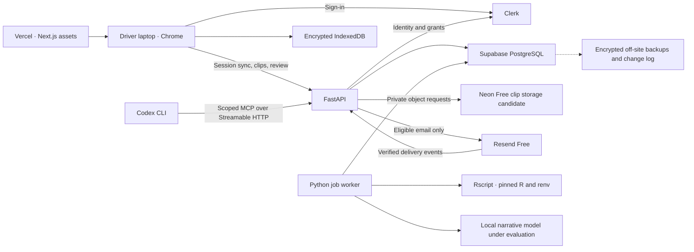

# RAFIQ technical requirements

**Engineering baseline · 20 November 2026 · Release owner: Ali Sameh**

RAFIQ runs live driver monitoring on a laptop and hosts each driver’s private session history, clips, analytics, and reports. A configured session must keep issuing local warnings throughout a 30-minute network outage. Hosted services must operate at zero project cost. The first delivery milestone is a stationary campus demonstration and evidence packet on **15 December 2026**.

The [published PRD](PRD.md) governs product scope, operating conditions, thresholds, and release approval. The [architecture spine](planning-artifacts/architecture/architecture-RAFIQ-2026-11-20/ARCHITECTURE-SPINE.md) records the binding technical decisions. This TRD translates them into component contracts, a logical schema, and acceptance tests. The [decision record](planning-artifacts/architecture/architecture-RAFIQ-2026-11-20/.memlog.md) preserves both rounds of selections. Exact builds, model weights, provider qualification, university hosting, and measured performance remain pending.

## 1. System and technology stack

The hosted application is a **modular monolith**. FastAPI owns the product API and private resource access. A separate worker executes durable jobs from the same application. The browser owns the camera, observation clock, live behavior policy, and warnings. Python orchestrates analysis. **R computes every statistical result**, including descriptive statistics and benchmark metrics.

| Component | Responsibility and boundary |
|---|---|
| Next.js + TypeScript on Vercel | Camera setup, monitoring and controls, private sync queue, dashboard, timeline, experiments, clip replay, report review. Fetch private data through FastAPI. Restrict caches of private responses across sign-out. Vercel is the selected frontend host. |
| Browser vision and recording | Benchmark MediaPipe landmarks and a small license-compatible ONNX browser model for remaining cues on CPU. Evaluate MediaRecorder video-only WebM/VP8. Package and verify required models and runtime assets before declaring offline readiness. |
| Python + FastAPI | Versioned REST/JSON ingestion, admission, owner and scope enforcement, session persistence, media gateway, emergency dispatch, report access and scoped remote MCP. Keep storage credentials, OAuth checks, and provider secrets server-side. |
| Supabase PostgreSQL | Authoritative structured records, jobs, grants, lifecycle state and validated results. SQLAlchemy and psycopg access PostgreSQL. Alembic owns schema migrations, constraints, and RLS policies. |
| Neon Free object storage | First candidate for private hosted clips. Supabase remains the authoritative source for ownership and object eligibility. Verify retrieval, upload, range support, retention, and cost controls before accepting the provider. |
| Python worker + Rscript | Claim PostgreSQL jobs under leases, prepare authorized inputs, execute versioned R analysis and store validated outputs. Pin the R runtime and restore packages with renv. |
| Report generation | A local license-compatible model may draft narrative from approved report fields once qualified. WeasyPrint produces PDF and python-docx produces Word from the driver-reviewed snapshot. |
| Identity and external integrations | Clerk handles verified email/password, recovery, and scoped OAuth qualification. Resend Free handles eligible supervised-pilot email. Codex CLI is the named remote MCP client. |

## 2. Session, recording, and offline contracts

**Start and observe (FR-04–08).** A verified, admitted driver starts while stationary after camera, offline-asset, and consent checks. Declining recording still permits monitoring. An active browser session evaluates all five behaviors and retains overlapping labels and times. One incident groups overlapping detections, and one combined warning explains the cues and durations. Qualifying duration, stronger warnings, allowed gaps, recovery, and cooldown use the versioned release policy in PRD §8.3. Acknowledgment preserves the observations. Camera loss, poor light, obstruction, or unreliable observation takes precedence over a warning, marks the interval, pauses monitoring, and clears emergency timers. Restored camera readiness plus manual resume starts fresh qualification.

**Record (FR-12).** Start an in-memory pre-event buffer only within the driver’s recording consent. Match the enabled categories, use three seconds before and after by default, and allow 0–5 seconds at each end. Retain the first bounded segment, cap it at 30 seconds and 20 MB, and indicate truncation. Discard unused context. Request camera video only. At queue or storage exhaustion, show the clip as unavailable and continue monitoring and warnings.

**Keep offline data private (AD-3).** Generate a random data key per driver and device. IndexedDB holds ciphertext and the wrapped form of the key. Only the configured session holds its usable key in memory. On sign-out, stop private processing, clear keys and decrypted UI state across open tabs, and lock the queue. The backend must verify the same driver before unwrapping the device key after reconnect. An already configured, signed-in session can continue offline. Expire queued clips 24 hours after capture. Revoking recording consent discards unsent clips and prevents a pending transfer from becoming available.

**Synchronize (FR-08, FR-11–13).** Assign stable UUIDs before enqueueing. Each versioned batch identifies the session, individual event IDs, elapsed session times, and observation or policy versions needed for replay. Preserve capture time separately for retention. The server derives the owner from authentication and checks each event’s parent, lifecycle, and identity. Return per-item acknowledgments after durable commit. Identical retries acknowledge the original write. Conflicting reuse of an ID is rejected. A partial batch or lost response can be retried without duplicating records. Retain pending items until acknowledged, permanently ineligible, or expired under their retention rule. Ending locally closes monitoring. Summary availability follows successful sync of its required data.

**Upload and replay (AD-4).** Upload clip bytes separately through FastAPI. Check consent, ownership, source incident, age, size and quota at admission and again before making the object available. A retry reuses the clip ID. Interrupted transfers stay private and orphaned bytes are purged. Deletion and expiry win races with finalization or retry. For playback and export, FastAPI authorizes each request, including byte ranges, and streams eligible bytes. Private bucket credentials and reusable provider URLs stay server-side. The UI distinguishes pending, available, and unavailable media.

## 3. Logical database schema

The following relations describe the required keys, relationships and lifecycle facts. Names illustrate the logical model. Alembic migrations establish physical columns and indexes during implementation. Driver-owned entities use UUID primary keys and a driver foreign key. A unique Clerk subject maps to one driver. For nested private resources, composite references such as `(driver_id, session_id)` must match the parent’s unique owner/ID pair. Apply equivalent constraints at the incident and clip levels so an owned row cannot reference another owner’s parent.

| Relation or related records | Keys, fields, and cardinality |
|---|---|
| Driver, preferences, device key | Driver has a unique Clerk subject, enrollment and lifecycle state, one set of private preferences, and many device registrations. Each registration binds a device identifier and wrapped-key reference to its owner. Credentials and recovery secrets stay in Clerk. |
| Recording consent, emergency contact | One driver has versioned consent records with categories, effective time and revocation. Up to two ordered contacts may be eligible. Persist verification and removal state. A changed address needs fresh recipient confirmation. |
| Session, observation interval | One driver has many sessions. A session has start/end, lifecycle, policy/model versions, and many intervals with elapsed bounds, pause cause, feed usability and class observability. Preserve eligible timestamped measurement series for what-if replay. |
| Incident, detection, warning | One session has many incidents and detections. A grouped incident retains its constituent detections with label, elapsed bounds, confidence, and supporting measurements. A warning identifies its incident and qualifying detections, severity, time, and acknowledgment. Store enough linkage to reproduce combined warnings. |
| Clip | A clip identifies its owner, incident, source consent, capture/expiry times, private object key, media type, size, truncation, and availability/deletion state. Deleting a clip preserves independent incident records. Search by session, date, or behavior through the owned incident. |
| Emergency sequence, attempt, provider event | A session may have multiple separately qualified sequences. Each records eligibility, cancellation, deadline and terminal state. An attempt belongs to one sequence and verified contact. Uniqueness per sequence/contact and provider-event deduplication prevent repeat sends. Precise location has separate permission and expiry. |
| Job, analysis run, result and inputs | Store job owner or controlled evaluation context, job type, input references/versions, lease and attempt state. Link one logical run to validated outputs with method, units, denominators, sample, seed, and version. Persist simulations independently of original measurements. |
| Study dataset, benchmark release | Version approved controlled inputs, driver-disjoint splits, labels, policy and scoring configuration. Persist publishable aggregate results separately. Keep private driver history outside the training and evaluation dataset. |
| Report, report source, export | A report references its owner, analysis results and all required sources through a many-to-many dependency relation. Bind review and exports to one immutable snapshot/version. Store artifact availability, download authorization and expiry. |
| MCP grant, sync receipt, deletion and recovery records | Bind grant to driver, client, scopes and revocation. Bind each sync receipt to owner, stable event ID and accepted content. Retain sufficient deletion state to prevent replay or restoration of erased data. Protect recovery records and respect purge deadlines. |

Index owner and parent keys used for authorization, owner/session time for history, expiry for cleanup, and runnable/leased job state for workers. Exercise ownership checks with the application database role in integration tests. A migration or database-owner credential would invalidate the RLS test.

## 4. Authentication, authorization, and security

The **driver account is the tenant boundary**. Clerk authenticates. FastAPI verifies the session and maps its subject to an admitted driver. For every private operation, the application checks the requested action and current ownership. The database independently applies driver-scoped row-level security. Set trusted driver context within the database transaction and clear it at its boundary so pooled connections cannot retain a previous owner. Use a least-privilege runtime role subject to RLS and separate restricted worker and migration privileges. Browser clients have no direct access path to private database tables or buckets.

| Actor | Permitted surface |
|---|---|
| Verified driver | Own profile, consent, settings, sessions, observations, clips, analytics, reports and grants. Pilot requires approved cohort membership. Public signup for eligible adults in Egypt opens only after release approval. |
| Supervisor | Stationary, driver-authorized controls on the driver’s device for that session only: acknowledge warnings, cancel an emergency countdown, and pause. Revocation or session end removes these controls. Driver retains start, resume, end and account access while stationary. |
| Verified emergency contact | Receive the eligible email and separately authorized location. Address confirmation confers no account, history or media access. |
| Authorized Codex CLI | Only driver-approved read and/or report-request scopes within §6. Ordinary driver browser credentials and MCP grants serve separate clients and permissions. |
| Worker and provider callbacks | Worker reads inputs for a claimed job and rechecks eligibility before publication. Verify Resend webhook authenticity before applying state transitions. Deduplicate repeated callbacks. |

Use HTTPS for all hosted traffic, encrypted private data at rest, secret storage specific to each environment, and private file responses that cannot enter shared caches. Verify token issuer, expiry and intended recipient or client as applicable. Reject expired or revoked authority, cross-owner references and ineligible sessions even when the caller knows a valid resource ID. Logs may include correlation IDs, counts, timing and coarse failure reasons. Exclude video, coordinates, tokens, contact details, raw measurements, and report text. Test unauthorized reads and mutations at API, database, media, export and MCP boundaries.

**Deletion and retention (FR-13).** Block access immediately on deletion or expiry, including links already issued. Hosted clips expire seven days after capture. Session and incident metadata expire 90 days after session end. Precise coordinates expire after 24 hours. Hosted reports expire 30 days after creation or earlier when a required source expires. Owner-authorized download links expire in five minutes and still require current authorization. Withdraw dependent reports, permit regeneration from eligible sources, and explain that downloaded copies remain with the driver. Purge retained copies, including backups, within 30 days. Include deletion during upload, offline retry, account deletion and backup restore in lifecycle tests. Verify university retention policy before retaining pilot recordings.

## 5. Statistical analysis and reports

**Execution contract (FR-14–19).** FastAPI records a job and immutable input references in PostgreSQL. The worker atomically claims a lease, runs a versioned R script, validates the result shape and persists the result once for that logical run. A reclaimed job may rerun. Only the current lease holder may publish, and expiry or source deletion invalidates the release. Record input versions, filters, method version, seed where used, units, denominator and sample size. The dashboard, reviewed exports, and MCP read the same validated result. The browser’s live timers and detector outputs feed this process.

| Product output | Required computation or evidence |
|---|---|
| Personal analytics | R computes counts, rates, percentages, durations, distributions and coverage. Report incident rates per elapsed monitored hour with coverage alongside. Exclude deliberate user pauses from elapsed monitoring time and include observation-loss pauses. Keep unusable observations distinguishable from valid negative observations. |
| Paired comparison | Two-sided paired permutation test of mean within-participant incident-rate differences. Require at least 10 complete pairs. Use a 95% paired bootstrap interval, 10,000 draws and seed 20261120. |
| Independent comparison | Two-sided Fisher’s exact test for the proportion with at least one incident. Require at least 10 participants per arm and report 95% Wilson intervals. For both designs label inference exploratory, use α = 0.05 and explain when only descriptive output qualifies. |
| What-if and Experiment Studio | Replay supported thresholds only against the owner’s compatible, eligible measurement series. Accuracy comparisons require reference labels. Start Studio with versioned synthetic paired and independent fixtures. Additional studies require institutional approval. Publish aggregate groups only at ≥10 distinct participants per visible group and suppress complementary totals that reveal smaller groups. |
| Benchmark | Separate by driver before tuning. Target 60/20/20 development, calibration and held-out splits. Require ≥5 held-out drivers, ≥20 independently staged positive episodes per behavior and ≥5 held-out monitored hours. Freeze labels, per-class policy, thresholds and dataset versions before scoring. Match at 10 Hz, exclude class-unusable frames, and report per-class coverage, precision, recall, F1, accuracy and confusion counts plus warning delay and false warnings/hour. Drivers receive approved aggregates. |
| Reports | Generate session and personal-trend reports. The local narrative model gets approved fields and validated figures only. Qualify model license, factual accuracy and speed on available hardware. Preserve units, methods and limitations. Include approved benchmark summary where applicable. The driver reviews a frozen snapshot in RAFIQ. Both export formats must reproduce it. |

## 6. External protocols

**Emergency email (FR-09–10).** Qualify Resend Free on the team’s existing DNS domain. Controlled pilot starting values are 10 seconds of continuous qualifying drowsiness followed by a distinct 15-second cancellation window. Ordinary warning acknowledgment does not cancel email. Recovery, cancellation or session end stops unsent attempts. Camera pause clears both timers. Fresh qualification after manual resume starts a full window. Never send from a queued historical incident. The dispatch path must establish current eligibility, contact verification, consent, live observation and deadline before each send. When connectivity prevents that check, withhold the send. Separately consented precise location is optional. Otherwise send only the minimal driver identifier, event time, and request to check in.

Allow one application-level attempt per verified contact in order, up to two contacts within 120 seconds from the start of the cancellation window. Show Pending, Accepted, Delivered, Failed and Unconfirmed. Resend `email.sent` means accepted for processing, and `email.delivered` is positive mail-server delivery evidence. Only a confirmed terminal failure allows an eligible next attempt before expiry. Hold ambiguous outcomes, including a crash across the send boundary, and close as Unconfirmed at expiry. A later bounce corrects the recorded status while leaving a previously delivered sequence closed. Quota exhaustion marks Failed and stops the sequence. Live pilot activation requires controlled evidence and Ali Sameh’s approval. Public launch keeps live email disabled. [Resend events](https://resend.com/docs/webhooks/event-types) · [Resend pricing](https://resend.com/pricing)

**Remote MCP (FR-20).** Qualify a preregistered Codex CLI client over Streamable HTTP with explicit driver consent and separate read and report-request scopes. Verify opaque Clerk token status and granted scope at each use and again at report release. If current authorization cannot be established, withhold access. Allowed reads cover own session identifiers, timestamps, durations, coverage, incident/behavior counts, validated aggregates with methods and units, and event identifier, class, relative start, duration, and severity. Report requests return an opaque ID and status. Review and download occur in RAFIQ. Exclude raw series, files and file links, contacts, locations, settings changes, recording, emergency and session controls. Repeat scope, cross-driver, and mid-job revocation checks in the named client before activation. [Clerk OAuth](https://clerk.com/docs/guides/configure/auth-strategies/oauth/how-clerk-implements-oauth) · [Codex MCP](https://developers.openai.com/codex/mcp)

## 7. Infrastructure, deployment, and recovery

| Environment or service | Deployment decision and evidence required |
|---|---|
| Development | Use local development with fixtures and isolated secrets. Use scripted deployments, versioned migrations and smoke tests. Pin JS and Python dependencies, R runtime and renv packages, image digests and model hashes in the first reproducible build. Record tested Chrome patch versions. |
| Frontend | Vercel hosts Next.js. Verify the actual account, project ownership, team use and pilot/public use qualify for a permanent zero-charge plan. Hobby restricts use to personal, non-commercial projects. Verify restrictions before each rollout. Keep previews isolated from pilot secrets and driver data. [Vercel Hobby](https://vercel.com/docs/plans/hobby) |
| API and worker | Prefer the always-on university host only after approval, access, capacity and recovery tests. For attended demos, evaluate a Render Free web service without a payment method, with R execution while attended. Free web services sleep after 15 idle minutes. Test a cold request, interrupted lease, restart, and resumption. A separately hosted always-on free worker is unconfirmed. [Render Free](https://render.com/docs/free) |
| Database and media | Supabase Free lists 500 MB per database and excludes managed point-in-time recovery. Measure observation and index growth at the 90-day retention horizon. Neon Free lists 5 GB of object storage. The 12-driver pilot’s full clip allowances total 3 GB, before other usage. At the public baseline, 100 fully provisioned drivers alone would need 50 GB. Test transfer quotas, isolation, object deletion and capacity independently for both rollouts. [Supabase pricing](https://supabase.com/pricing) · [Neon pricing](https://neon.com/pricing) |
| Clerk, Resend, model resources | Verify features, free quotas, no paid add-ons or automatic overages, DNS setup and controlled recovery flows on the actual accounts. For MCP, verify opaque tokens, consent, scopes, revocation and access to the named client at zero project cost. Resend’s PRD baseline is 100 emails/day and 3,000/month. Validate workload before live use. Evaluate local model hardware separately. [Clerk pricing](https://clerk.com/pricing) · [Resend pricing](https://resend.com/pricing) |
| Release and operations | Keep the pilot isolated from development data, credentials, grants, object namespaces and provider webhooks. Deploy compatible migrations and matching API/worker versions; exercise rollback with retained data before pilot admission. Monitor availability, request latency, job/backup lag, remaining quota, upload outcomes and expiry/purge progress using privacy-filtered measurements. |

**Recovery contract.** Store encrypted off-site backups plus a durable ordered log of changes, including deletions, in a location independent of the primary failure. Select and qualify a zero-charge destination and demonstrate authorized key recovery. Restore to an isolated environment, replay changes to a known position, reconcile private object references and outstanding jobs, and reapply deletion/revocation state **before reopening reads**. Do not resend historical emergency attempts during recovery. Check acknowledged writes, restored artifact accessibility, expiry and purge across backups and log segments. Measure the time until usable service returns and the age of the newest recoverable committed data. A backup stored only alongside the primary cannot establish these targets. [Supabase backup guidance](https://supabase.com/docs/guides/platform/backups)

**Zero-budget release rule.** Use only services that cannot charge the project and existing approved resources supplied at no cost. Verify plan, ownership, hard limits and exhaustion behavior before sending pilot data to any provider. Quota alerts alone cannot establish the spending constraint. Hold the affected capability or rollout when a target fails. Keep the original target and the failed test in the evidence packet.

## 8. Measurable acceptance and release gates

These are acceptance targets. Record setup, build, dataset or fixture, workload, observed value, and pass/fail for each. Ali Sameh freezes the applicable protocol before sign-off measurements. PRD §§6–8 govern accessibility, thresholds, operating conditions and capability-specific gates. [Approved PRD](PRD.md)

| Gate | Acceptance target and verification |
|---|---|
| NFR-01 · reference device | Test the latest patched current and immediately previous Chrome major on Windows 11 x64. Run a 30-minute CPU-only session on four logical cores, 8 GB RAM and built-in 720p/30 fps camera. Survey cohort hardware and record exact builds. |
| NFR-02 · pilot / public load | At 20 / 100 concurrent signed-in users, dashboard p95 ≤3 s / ≤2 s. Exercise 5 / 20 concurrent uploads and 250 / 500 MB hosted clip allowance per driver. In both environments ≥95% of supported uploads of up to 20 MB complete within 60 s on a 5 Mbps uplink. Exercise FastAPI’s media path. |
| NFR-03 · offline integrity | After setup, run 30 continuous offline minutes on the minimum device. Cap queued clips at 100 MB or 20 clips, whichever comes first. On disconnect, restart, reconnect and retry, expect zero missing or duplicate eligible records within limits. Test queue exhaustion, account switching and consent withdrawal. |
| NFR-03 · hosted recovery | ≥99% hosted availability over the seven-day pilot. Controlled service restart restores use within 15 minutes. Disaster drill demonstrates ≤5 minutes of hosted data loss. Preserve deletion blocks during restore and capture measured recovery evidence. |
| NFR-04 · accessibility | Verify all applicable PRD workflow checklist items with keyboard and screen reader for setup and review. Verify warnings remain distinguishable without color, optional audio can be disabled, and visual customization preserves a visible warning. |
| NFR-05 · privacy | Exercise two drivers, switched browser accounts, changed IDs, direct media/range requests, expired links, revoked OAuth during generation, and deletions during upload and restore. Expect zero unauthorized records, bytes or reports released on subsequent requests, immediate denial on expiry/deletion, and retained copies purged within 30 days. |
| NFR-06 · operation and emergency | Test camera pause overriding stale warnings, manual resume, fresh dwell and countdown, stationary readiness and supervisor-only motion controls. Expect zero unintended emails in cancellation, stale-contact, camera-pause, expiry and duplicate-event fixtures. Conduct staged behavior tests stationary or in a simulator. |
| SM-01 · pilot journey | 10 of 12 eligible drivers complete verified sign-in, camera readiness, start, finish and summary unassisted in one scheduled attempt each within seven days. Apply PRD §8.4 counting and withdrawal rules. |
| SM-02–05 · detection | Held-out precision/recall targets are 90%/90% for drowsiness, 85%/85% for distraction, and 85%/80% each for active phone use, eating and drinking. Target ≤2 false warnings per monitored hour, p95 qualification-to-visible-warning ≤750 ms and ≥90% overall coverage in supported normal conditions. Report per-class coverage and degraded fixtures separately. |
| FR-14–20 · reproducibility and release | Repeat matching inputs, seeds and versions. Require exact counts and absolute error ≤0.000001 for unrounded analysis results. Match reviewed figures in both exports. Exercise minimum sample sizes, group suppression, report withdrawal and actual Codex CLI authorization before enabling the applicable surfaces. |

**Release sequence.** The campus demo uses the stationary core workflow and an evidence packet. The seven-day pilot requires its own qualifying host, controlled-use procedure, privacy checks and recovery evidence. The public rollout requires pilot completion, held-out benchmark, public capacity, privacy/lifecycle, accessibility, analytics, reports and named-client MCP qualification. Free-plan eligibility and resource ceilings must pass at public scale. University host availability, independent backup location, device and model results, all exact build pins, private Neon storage, Clerk OAuth, Resend delivery, local narrative quality, and measured capacity and recovery remain open evidence items. Release approval belongs to Ali Sameh.

