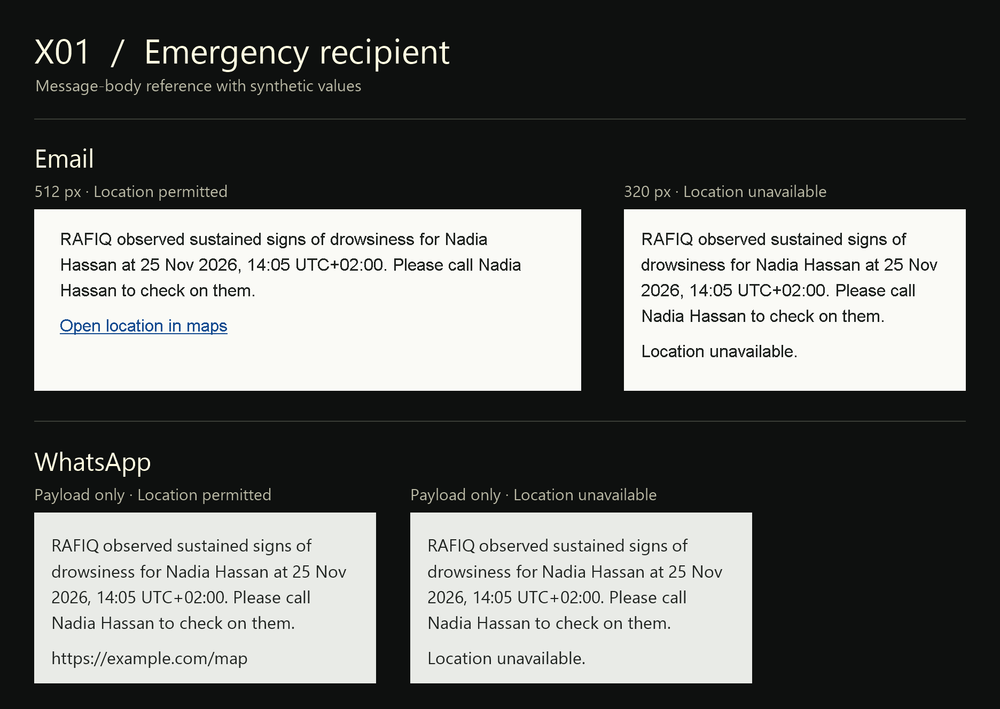

# X01 · Emergency recipient

Approved for Pen.dev implementation on 25 November 2026. The selected email treatment is single-column HTML with a plain-text fallback.

The recipient is a driver-registered emergency contact opening an authorized alert in email or WhatsApp. The job is to understand what RAFIQ observed and when, then call the driver to check on them. When the driver has separately permitted sharing and a usable location exists, the recipient can open it directly from the message. Both channels support reading without a RAFIQ account or check-in. **Mode** Operate. [X01 screen requirements](../../SCREENS.md#x01-emergency-recipient) · [Approved alert policy](../../PRD.md#85-emergency-alerts-by-email-and-whatsapp)

## Message and variants

> RAFIQ observed sustained signs of drowsiness for [driver name] at [time]. Please call [driver name] to check on them.

Insert the same driver name in both positions and the event's observation time in the time position. Keep the complete paragraph, including the call request, in reading order on both channels. The recipient calls the driver using their usual calling tools. D21 owns the driver-facing preview and location-sharing choice. D04 owns the alert countdown. D08 owns in-app delivery evidence. Opening or replying to a message is separate from provider-confirmed delivery. [D21 preview](D21-SHAPE.md#alert-message-preview) · [Emergency delivery experience](../../EXPERIENCE.md#emergency-mode-and-delivery-evidence)

| Location at dispatch | What the recipient receives |
| --- | --- |
| Separately permitted and usable | Append a usable map location or direct map link immediately after the alert. The email reference shows an underlined **Open location in maps** link. The WhatsApp reference shows the map-link payload form. A native location attachment can be represented if the qualified template and delivery path support it. |
| Permission absent or withdrawn, or usable location missing | Append exactly **Location unavailable.** as readable text. The message carries no location data or map affordance. |

The board uses a synthetic name, observation time, and example URL. **Open location in maps** is a proposed email link label. Production timestamp formatting and time zone, sender display identity, subject and any custom preheader still need confirmation. The WhatsApp payload's permitted location representation depends on provider qualification. [Emergency-channel qualification](../../TRD.md#6-external-protocols)

## Email presentation selected

- Use a single left-aligned fluid column. One regular-weight paragraph leads, followed by the location line. The reference uses a 512 px desktop body and a 320 px narrow body, regular 16 px system text with roughly 24 px leading, and 16–24 px insets. Use selectable text, native link focus and a descriptive, underlined map link. Allow wrapping at narrow widths and at 200% zoom, including long names and time strings. Keep the unavailable notice at body contrast. [W3C reflow](https://www.w3.org/WAI/WCAG22/Understanding/reflow.html) · [W3C link purpose](https://www.w3.org/WAI/WCAG22/Understanding/link-purpose-in-context.html)
- Deliver the same paragraph and location outcome as an explicit plain-text alternative. Put the direct URL on the following line in the permitted version. Resend accepts HTML and plain-text bodies. Keep essential typography and spacing inline, with a meaningful reading sequence even if styles are stripped. Use system font fallbacks and verify link and text contrast in the client's light and dark renderings. [Resend Send Email](https://resend.com/docs/api-reference/emails/send-email) · [Gmail HTML email CSS](https://developers.google.com/workspace/gmail/design/css)
- The alternative was plain-text-only email. It offers the simplest presentation across readers and exposes the URL directly. The selected HTML treatment keeps the same reading order and provides a descriptive map link, with plain text available wherever the email reader uses it.

## Pen.dev boards and delivery checks

The editable [RAFIQ Pen document](<../../../Pen Design/RAFIQ.pen>) contains both boards.

| Board | Pen node | Coverage |
| --- | --- | --- |
| X01 · Emergency recipient | `x0PSF` | Desktop and narrow HTML email plus both WhatsApp payload variants |
| X01 · Plain-text email alternatives | `i0uh7e` | Both location outcomes in the email fallback |

- Use the static payload references to show the fixed text and the two location outcomes. WhatsApp owns the surrounding interface, wrapping, message timestamps, link previews, and native location rendering. Show the observation time inside the alert text even if the client displays a separate message time.
- The boards use editable paragraphs with the channel and variant annotations outside each payload. The email map label is visibly underlined. Pen.dev dropped the fixture hyperlink, so the label is a static visual reference.
- All six samples were checked against D21 for the full body and their location outcome. During delivery qualification, check direct map opening without RAFIQ sign-in, keyboard and screen-reader reading order in email, narrow-width and enlarged text, and light/dark client rendering. Check native WhatsApp rendering and provider delivery independently.
