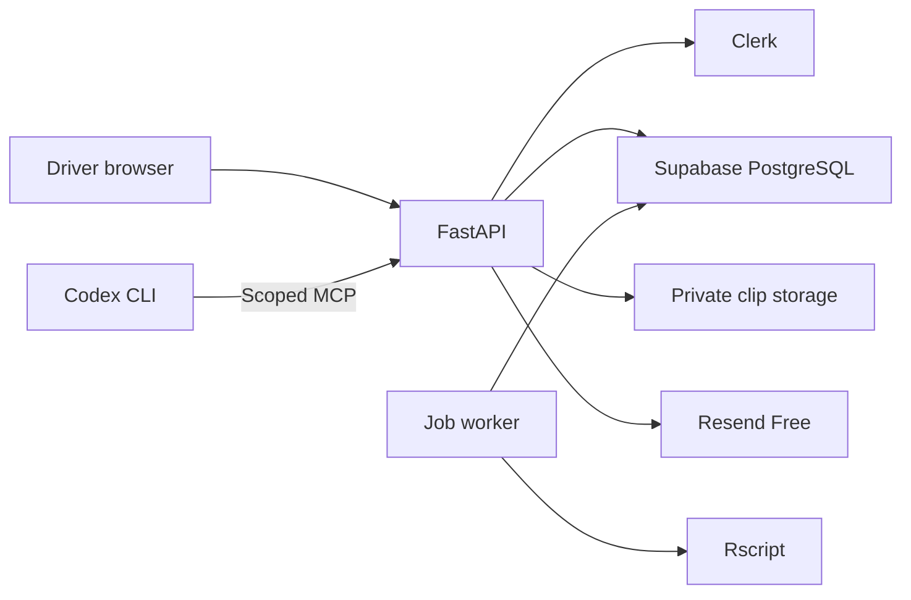

# RAFIQ architecture decisions

The [approved PRD](../../../PRD.md) governs product behavior and release targets. The [decision record](.memlog.md) records Ali Sameh’s architecture choices. Engineering uses this spine as the architectural source of truth and the [TRD](../../../TRD.md) for contracts and verification.

## Design paradigm

A modular monolith owns hosted product operations. The browser owns time-critical monitoring. The worker runs durable analysis and report jobs. Only the product API exposes private driver data to clients.

## Invariants and rules

### AD-1 — Local monitoring [ADOPTED]

- **Binds:** Browser, capture, FR-04–08 and FR-12.
- **Prevents:** A network call, queue limit or background job interrupting live feedback.
- **Rule:** Next.js and TypeScript own readiness, on-device inference, warnings and the configured offline session. Use the approved release policy. Camera loss takes precedence, clears escalation timers and requires manual resume. Capture only consented matching incidents, video only. Qualify MediaPipe, a small ONNX model and WebM/VP8 on the reference CPU.

### AD-2 — Driver ownership [ADOPTED]

- **Binds:** Identity, persistence, files, reports and MCP, FR-01–03 and FR-20.
- **Prevents:** Valid credentials granting access to another driver.
- **Rule:** Clerk verifies email/password identity and recovery. FastAPI derives the driver from the verified subject, enforces admission, ownership and action scope. Database access for private operations runs with driver-scoped RLS and owner-aware relationships. Supervisor controls are temporary and local. Verified contacts receive only the eligible email.

### AD-3 — Offline synchronization [ADOPTED]

- **Binds:** Browser queue, ingestion and database, FR-08 and FR-11–13.
- **Prevents:** Same-browser disclosure, duplicate records and resurrected data.
- **Rule:** Encrypt IndexedDB items with a random driver/device key. Persist it only wrapped, unlock through FastAPI after same-driver reauthentication and clear the usable key on sign-out. Batch versioned REST/JSON with stable UUIDs, elapsed timestamps and per-item acknowledgments. Acknowledge each item only after durable commit. Identical retries acknowledge the original write. Reject conflicting ID reuse. Recheck lifecycle and never revive deleted items. Upload video separately.

### AD-4 — Data and media authority [ADOPTED]

- **Binds:** Product API, migrations, storage and replay, FR-11–13.
- **Prevents:** An alternate store or a public object URL bypassing access rules.
- **Rule:** Supabase PostgreSQL owns structured records through SQLAlchemy, psycopg and Alembic. Neon Free private object storage is the first clip candidate. FastAPI authorizes each upload, playback range and report download using current consent where applicable, owner, source validity and expiry. Block access immediately at deletion or expiry and purge retained copies by the PRD deadline.

### AD-5 — Statistical authority [ADOPTED]

- **Binds:** Worker, dashboard, benchmark, simulations, Studio and reports, FR-14–19.
- **Prevents:** Different numbers across product surfaces or a simulation changing live policy.
- **Rule:** A modular Python FastAPI application submits durable PostgreSQL jobs. A worker claims jobs with leases and runs versioned Rscript inputs through pinned R and renv. R alone computes statistical results. Consumers read validated results with input and method provenance. Use a single versioned contract for elapsed timestamps, class usability, pause causes, and incident grouping across live capture, replay and benchmark scoring. Only the current lease holder publishes once per run after checking source and initiating grant validity. R applies distinct-participant thresholds and complementary suppression before releasing any study result. Test exact counts and PRD numerical tolerance. Separate private sessions, simulations, controlled benchmark splits and publishable aggregates.

### AD-6 — Report and MCP release [ADOPTED]

- **Binds:** Worker, reports, exports and Codex CLI, FR-19–20.
- **Prevents:** Stale exports, unreviewed figures and access through a revoked grant.
- **Rule:** Evaluate a local license-compatible narrative model using approved fields only. Produce PDF and DOCX from one reviewed snapshot using WeasyPrint and python-docx. Qualify remote Streamable HTTP with a preregistered Codex CLI client, explicit consent, separate read/report-request scopes and opaque Clerk tokens. Recheck authorization on every request and release. Enforce the PRD §8.8 response field allowlist in the MCP adapter. Return report IDs and status through MCP.

### AD-7 — Emergency email eligibility [ADOPTED]

- **Binds:** Local timers, FastAPI, Resend Free, FR-09–10.
- **Prevents:** Network recovery or ambiguous delivery triggering a stale or duplicate email.
- **Rule:** Keep live email disabled at initial public release. Only an eligible supervised pilot can send after separate approval. The browser tracks observation, cancellation and fresh qualification. The backend checks live eligibility, consent, deadline and verified contacts before each send, using fresh online confirmation from the browser specific to that attempt. Dispatch only once while eligible. Cancellation before dispatch wins. Uncertain confirmation or outcome cannot trigger another send. Follow PRD §8.5 for delivery evidence, ordered attempts, cancellation, expiry and separately consented location.

### AD-8 — Deployment and evidence [ADOPTED]

- **Binds:** All components, NFR-01–06.
- **Prevents:** A demo configuration or free-tier listing being treated as operational evidence.
- **Rule:** Host the frontend on Vercel. Prefer a confirmed, approved always-on university host for FastAPI and the worker. Evaluate no-payment-method Render Free at attended demos, including interrupted jobs. Keep local development and pilot isolated. Enforce zero charge across services, measure PRD targets, restore from encrypted independent backups and a durable change log including deletions. Apply deletion, expiry and revocation before restored reads. Allowlist operational log fields and exclude credentials and private payloads. Hold each affected release until evidence passes. Pin exact tested builds, models and images in the reproducible build.

## Deferred

Record tested build versions, license and model hashes after the first reproducible build. Record device results, host approval, free-plan eligibility, private storage and transfer tests, recovery destination and drills, local model evaluation, live email and MCP qualification before their respective activations. Use the criteria in the [technical requirements](../../../TRD.md). These evidence gaps do not authorize substituting providers or lowering PRD targets.

